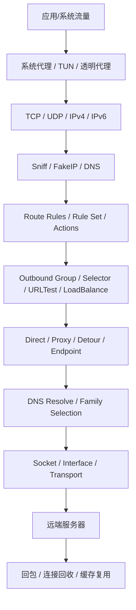
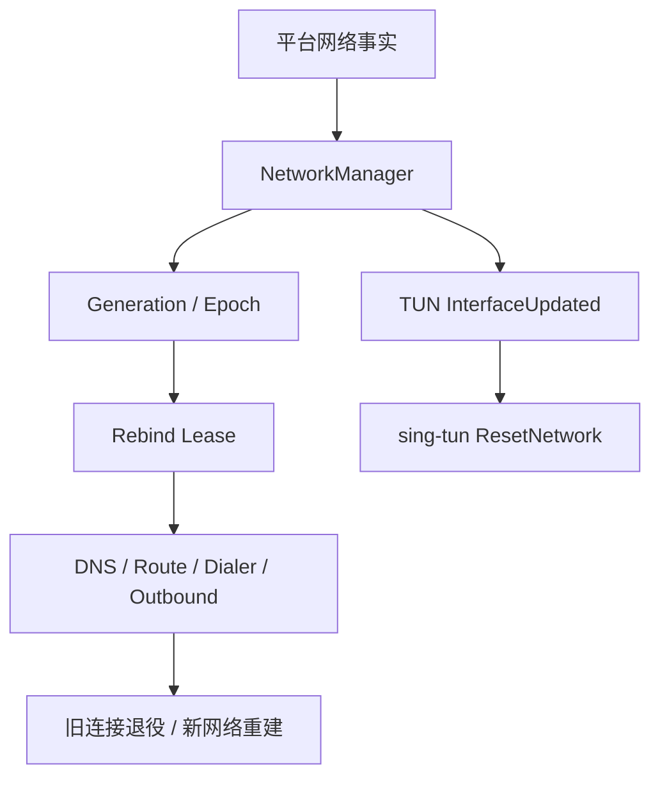
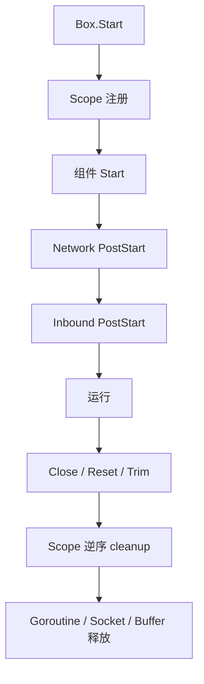
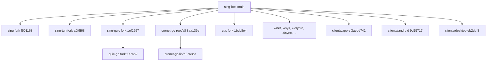

# 全内核与依赖组合生产级审计报告

**报告文件：** `KERNEL_FULL_AUDIT_REPORT_20261028.md`  
**审计对象：** `Piggy-Cat-bit-shadow/sing-box`，`testing` 分支  
**审计 HEAD：** `fec235746cc943b9965c8453e82a8a42890505ab`（2026-10-28 02:22 +0800）  
**产品版本：** `release/JIEJIE_VERSION = 0.1.30`；当前 HEAD 为 `v0.1.30-3-gfec235746cc`  
**审计性质：** 只读源码审计、依赖 Pin 审计、跨仓库调用链推演、受控现有测试；未修改源码、测试、配置、依赖、Pin、Tag 或远端状态。  
**报告日期：** 2026-10-28  
**最终代码 HEAD：** `1ff0af39110d4bd4044c817a0bf209ff01e21f7a`（TUN post-start reset 回归修复）；文档归档提交另计

> **结论先行：** 当前内核没有发现 P0；确认 **2 个 P1、10 个 P2、3 个 P3** 的生产级问题。最严重的是：普通 TUN 在显式 `dns_address` 下可能完全绕过 DNS Hijack（DNS 泄漏/策略绕过），以及 Linux kTLS + mixed/redirect 的 splice 下载路径会在合法 TLS 控制记录上 panic。另有 Naive 证书 Pin 被静默忽略、TUN 网络重置空指针竞态、QUIC Owned DATAGRAM 所有权泄漏、组出站候选地址/接口策略丢失、活跃 TCP 静默停滞等问题。  
> **发布判断：** 不是“全仓不可发布”，但上述 P1/P2 应进入下一次补丁版本；尤其是使用显式 DNS 地址的 TUN、Linux kTLS、Naive 证书 Pin、组出站双栈场景。当前 `v0.1.30` 已发布，本报告不建议移动该 Tag；修复应进入后续版本。

---

## 1. 审查摘要

### 1.1 真实基线

| 项目 | 实测值 |
|---|---|
| 分支 | `testing` |
| HEAD | `fec235746cc943b9965c8453e82a8a42890505ab` |
| 工作区起始状态 | clean（`git status --porcelain=v1` 为空） |
| 版本文件 | `0.1.30` |
| 当前描述 | `v0.1.30-3-gfec235746cc` |
| 远端 | `origin = Piggy-Cat-bit-shadow/sing-box`；`upstream = SagerNet/sing-box` |
| 知识库生产基线 | `5fc4f9366a60202fdc7c98cd6fa280cceace65ba`（`v0.1.9`） |
| 知识库基线到 HEAD | **783 commits**；`git diff --shortstat` 为 **2142 files changed, 634917 insertions(+), 5393 deletions(-)** |
| 生产 Go 文件变化 | **254 个非测试 `.go` 文件**，`+24820 / -3120`（子审查实测） |
| 本次依赖审计 Pin | 见 §13；6 个核心 Fork 与 31 个 cronet-go 模块 Pin 均已核对 |

**知识库不是 HEAD。** `KNOWLEDGE/BASELINE.md` 明确写着“baseline IS HEAD”，但当前真实 HEAD 比它多 783 个提交、254 个生产 Go 文件。所有旧模块的行号、行为结论、修复状态都不能直接当作当前事实；本报告以当前源码和当前 Pin 为准。

### 1.2 完成度与覆盖

- **深审：** 主仓库 TUN、双栈、splice/拷贝、路由组、DNS/FakeIP、快速路径、生命周期；`sing` 的 Copy/Splice/Owned Buffer；`sing-tun` 的 Go stack/ResetNetwork/TUN 入口；`sing-quic`/`quic-go` 的 Owned DATAGRAM、MTU；`utls` 的 ECH 握手路径；`cronet-go`/Naive 的 TLS 选项映射。
- **源码审查：** `dns/`、`common/sniff/`、`common/runtimecoord/`、`adapter/`、`protocol/naive/`、`protocol/tuic/`、`route/rule/`。
- **接口核对：** Apple/Android 子模块 Pin 与 libbox ABI 契约；Dashboard 未检出源码，标记 `NOT_COVERED`。
- **未覆盖/环境阻断：** 真实 TUN/auto_redirect 内核行为、真实 kTLS 运行时、Cronet 原生库 ABI/符号链接、真实 Apple/Android 设备、真实 QUIC/MASQUE 对端、NAT64/DNS64 现网。全部明确标为 `UNVERIFIED` 或 `BLOCKED_BY_ENVIRONMENT`。

### 1.3 缺陷计数

| 等级 | 数量 | 说明 |
|---|---:|---|
| P0 | 0 | 未发现可可靠触发的系统性数据破坏/核心安全崩溃 |
| P1 | 2 | 普通 TUN DNS 绕过；Linux kTLS splice panic |
| P2 | 10 | 崩溃竞态、安全 Pin 失效、QUIC 所有权泄漏、组候选丢失、活跃停滞、入口家族锁存、销毁后投递、KeyUpdate 缺失、ECH 静默失效、Cronet Start 假成功 |
| P3 | 3 | TUIC/MASQUE 证明上限未传播、Box.Close panic 后假成功、规则集刷新无超时 |

**置信度：** `CONFIRMED` 1（活跃停滞，有现有单测断言）；`HIGH_CONFIDENCE` 14（源码可构造，缺设备/运行时执行）；`POSSIBLE` 0。  
**证据等级：** `VERIFIED_GIT`（基线/Pin）、`VERIFIED_SOURCE`（全部缺陷的核心证据）、`VERIFIED_UNIT`（活跃停滞、现有包测试）、`VERIFIED_CI` 仅用于历史 CI 记录，不用于替代本次源码结论。

### 1.4 最大实际风险

1. **显式 `dns_address` 的普通 TUN**：`dnsHijackAddress` 为空，`dnsHijackByPort` 只在 `auto_redirect` 分支赋值；DNS 查询可能作为普通 UDP/TCP 流离开，绕过 DNS 规则、FakeIP 与 DNS 路由。这是**用户可感知的 DNS 泄漏/解析失败**，不是理论问题。
2. **Linux kTLS + mixed/redirect**：`sing` 的 splice 在 `HandleSyscallReadError` 成功返回 nil 后无条件 `E.Cause(nil, ...)`，`exceptions.Cause` 直接 panic；无 recover，进程崩溃。该路径只在显式 `kernel_rx` + 可 splice 入站时可达，但一旦命中是整进程崩溃。
3. **Naive 证书 Pin 被静默忽略**：配置可写 `certificate_sha256` / `certificate_public_key_sha256`，但 Naive 只映射 CA 根证书，不做 Pin；操作者以为在 Pin，实际接受任意 CA 签发证书。

### 1.5 是否阻断正式发布

- **没有 P0 级“所有用户必坏”问题。**
- **P1 对特定配置是发布阻断级**：使用显式 `dns_address` 的 TUN 用户、Linux kTLS 用户。
- 当前 `v0.1.30` 已发布；不要移动 Tag。建议下一次补丁版本优先修 P1，再修 P2。P3 可随同版本修复。

### 1.6 本次无法验证的结论

- 未在真实 Linux 上执行 kTLS splice；未在真实 TUN/auto_redirect 上执行 DNS Hijack；未在真实 Apple/Android 设备上执行唤醒/网络切换；未链接或运行 Cronet 原生库；未做真实 QUIC/MASQUE 对端互操作。
- 因此 kTLS panic、TUN DNS、ResetNetwork、TUN 销毁后回调等属于**源码可构造 + 高置信度**，不是“已在设备复现”。

---

## 2. 当前内核架构与关键链路

### 2.1 数据平面



关键事实：

- TUN 入口在 `protocol/tun/inbound.go`；Go stack 在 pinned `sing-tun`。
- 路由后的连接建立在 `route/conn.go`：流连接用 `dialer.DialSerialNetwork`，包连接用 `dialer.ListenSerialNetworkPacket`。
- 组出站是**控制平面对象**，选择后不包裹连接；`Selector`/`URLTest`/`LoadBalance` 都只把 `DialContext`/`ListenPacket` 交给选中成员。
- FakeIP 只改写 `metadata.Destination` 为 `Fqdn` 并置 `FakeIP=true`；**不写 `metadata.Domain`**。这是当前源码行为，也是 0.1.30 后修复的 FakeIP 嗅探绕过的基础。

### 2.2 控制平面



- 一次恢复是 **lease 身份**，不是布尔值；`runtimecoord` 的 epoch 单调、lease 只允许当前 owner 完成。
- 平台网络事实只提供 level/edge；核心决定 policy。
- 现有 `NetworkManager` 在首次环境建立、接口变化、重置时调用 `Reclaim`；**稳态没有定时器**。这直接导致 BUG-007。

### 2.3 生命周期



- `Scope.Close` 只执行 `scope.Add` 的 cleanup，**不会自动调用任意对象的 Close**。
- Start 失败必须回滚；Close 幂等；cleanup 晚注册时在注册 goroutine 同步执行。
- 本次发现的 TUN 销毁后规则集回调、Box.Close panic 假成功，都是这条边界上的真实漏洞。

---

## 3. 全模块审查矩阵

| 模块 | 关键源码 | 审查深度 | 发现数量 | 风险级别 | 验证状态 |
|---|---|---|---:|---|---|
| TUN / 透明代理 | `protocol/tun/`, pinned `sing-tun` | DEEP_AUDITED | 3（DNS Hijack、Reset 竞态、销毁后回调） | P1/P2 | `VERIFIED_SOURCE`；无真实 TUN |
| 双栈 / family | `common/dialer/dual_stack_*`, `family_capability.go`, `dns/router_dual_stack.go` | DEEP_AUDITED | 1（入口 presentment 锁存） | P2 | `VERIFIED_SOURCE`；mapped 修复已复核 |
| Sniff / FakeIP | `common/sniff/`, `route/route.go` | DEEP_AUDITED | 0 新增（当前 FakeIP 绕过已修） | — | `VERIFIED_SOURCE` + `VERIFIED_UNIT` |
| DNS | `dns/`, `route/dns.go`, FakeIP | SOURCE_REVIEWED | 0 新增（旧 generation 检查存在） | — | 源码；无现网 DNS |
| Route / 规则集 / 组 | `route/`, `route/rule/`, `protocol/group/` | DEEP_AUDITED | 3（组候选丢失、销毁后发布、刷新无超时） | P2/P3 | `VERIFIED_SOURCE` |
| Fast Path / Offload | `route/fast_path.go`, `bypass_verdict.go` | SOURCE_REVIEWED | 0 新增 | — | 源码；无 Linux auto_redirect |
| TCP/UDP 数据平面 | `route/conn.go`, `conn_halfclose.go`, `splice.go` | DEEP_AUDITED | 2（活跃停滞、kTLS splice） | P1/P2 | 活跃停滞 `VERIFIED_UNIT` |
| `sing` Copy/Splice | pinned `sing` | DEEP_AUDITED | 2（kTLS panic、KeyUpdate） | P1/P2 | `VERIFIED_SOURCE`；Windows 无法跑 Linux |
| `sing-tun` | pinned `sing-tun` | DEEP_AUDITED | 1（ResetNetwork nil） | P2 | `VERIFIED_SOURCE` |
| `sing-quic` / `quic-go` | pinned 两仓 | DEEP_AUDITED | 2（Owned DATAGRAM 泄漏、上限未传播） | P2/P3 | `VERIFIED_SOURCE`；无真实 QUIC |
| `cronet-go` / Naive | pinned cronet + `protocol/naive` | SOURCE_REVIEWED | 2（Pin 忽略、Start 假成功） | P2 | 静态；原生 ABI 未链接 |
| `utls` / TLS/ECH | pinned utls + `common/tls` | SOURCE_REVIEWED | 1（ECH 静默失效） | P2 | 静态；无真实 ECH 对端 |
| Lifecycle / Scope | `box.go`, `adapter/lifecycle.go` | DEEP_AUDITED | 2（销毁后回调、Close 假成功） | P2/P3 | 源码 |
| 内存/电量/调度 | `common/power`, `trafficsched`, `bufgeom` | INTERFACE_CHECKED | 0 新增 | — | 未穷尽 |
| 配置/Schema | `option/`, `schema/` | INTERFACE_CHECKED | 1（Naive Pin 可写但不生效） | P2 | 源码 |
| 构建/发布 | `release/`, `include/`, workflows | SOURCE_REVIEWED | 0 Pin 缺失；1 可达性限制 | — | Pin/`go.sum` 已核对 |
| Apple / Android 子模块 | `clients/*` gitlinks | INTERFACE_CHECKED | 0 内核归属缺陷 | — | 未做完整客户端源码审计 |
| Dashboard | 不在 `.gitmodules` | NOT_COVERED | — | — | 无源码 |

### 3.1 协议/传输覆盖清单（避免“全仓通过”式误报）

| 协议/传输 | 关键源码 | 审查深度 | 本次发现 | 说明 |
|---|---|---|---|---|
| Direct / Block / DNS | `protocol/direct`, `protocol/block`, `protocol/dns` | SOURCE_REVIEWED | 0 新增 | family/dial 修复已复核 |
| SOCKS / HTTP / Mixed / Redirect | `protocol/socks`, `protocol/http`, `protocol/mixed`, `protocol/redirect` | INTERFACE_CHECKED | 0 新增 | 未逐协议深审 |
| Shadowsocks / ShadowTLS / Snell | `protocol/shadowsocks`, `protocol/shadowtls`, `protocol/snell` | INTERFACE_CHECKED | 0 新增 | TCP/UDP 未逐一实测 |
| Trojan | `protocol/trojan` | INTERFACE_CHECKED | 0 新增 | 依赖通用 TLS/Dialer |
| VLESS / VMess | `protocol/vless`, `protocol/vmess` | INTERFACE_CHECKED | 0 新增 | 未深审所有传输组合 |
| XHTTP | `transport/xhttp`, `protocol/vless` | INTERFACE_CHECKED | 0 新增 | 未覆盖 XMUX/上下行并发全分支 |
| AnyTLS | `protocol/anytls` | SOURCE_REVIEWED | 0 新增 | 双栈/PrefersIPv4 已复核 |
| Naive | `protocol/naive` | DEEP_AUDITED | BUG-004/014 | native ABI 未链接 |
| MASQUE / CONNECT-IP | `transport/masque` | DEEP_AUDITED | BUG-005/012 | 真实对端未测 |
| Hysteria2 | `protocol/hysteria2` | SOURCE_REVIEWED | 0 新增 | ceiling/PMTUD 对照正确 |
| TUIC | `protocol/tuic` | DEEP_AUDITED | BUG-012 | 迁移未实测 |
| WireGuard | `protocol/wireguard` | INTERFACE_CHECKED | 0 新增 | 未做设备互通 |
| OpenVPN / OpenConnect | `protocol/openvpn`, `protocol/openconnect` | INTERFACE_CHECKED | 0 新增 | 未做真实服务端 |
| SSH / Tor | `protocol/ssh`, `protocol/tor` | INTERFACE_CHECKED | 0 新增 | 未做真实网络 |
| UoT | `common/uot` + protocol adapters | SOURCE_REVIEWED | 0 新增 | 目标 ACL 未完整深审 |
| 组（Selector/URLTest/LoadBalance） | `protocol/group` | DEEP_AUDITED | BUG-006 | 候选/策略丢失 |

**说明：** `INTERFACE_CHECKED` 不等于该协议正确；只表示本次检查了它与通用 Dialer/TLS/UDP 的接口契约，未逐分支深审。报告不会把这些行写成“PASS”。


---

## 4. 真实生产 Bug 清单

### BUG-001

**标题：** 普通 TUN 在显式 `dns_address` 下不再执行 DNS Hijack，查询可绕过 DNS 规则/FakeIP  
**严重程度：** P1  
**置信度：** HIGH_CONFIDENCE  
**证据等级：** `VERIFIED_SOURCE`  
**影响平台：** 全平台普通 TUN（非 auto_redirect 的 `auto_route`/`dns_mode:hijack`）  
**影响模块：** `protocol/tun` + `sing-tun` flow dispatch

**源码位置：**

- `protocol/tun/inbound.go:561-565`：只有 `len(t.tunOptions.DNSAddress) == 0` 才填充 `t.dnsHijackAddress`。
- `protocol/tun/inbound.go:477`：`dnsHijackByPort` 只在 `if options.AutoRedirect` 分支内赋值。
- `protocol/tun/inbound.go:1095-1099`：`JudgeFlow` 第 2 步只查 `dnsHijackAddress`。
- `protocol/tun/inbound.go:1181`：`isDNSHijackDestination` 只查同一空列表或 `dnsHijackByPort`。
- `sing-tun/flow_dispatch.go:403,577-583`：Go stack 只根据 verdict 进入 `hijackDNSPacket`，没有独立的配置地址检查。
- `sing-tun/tun.go:161-186`：`Inet4/6DNSAddress()` 在显式 `DNSAddress` 时返回配置列表，说明这个列表本来可被填充。

**关键调用链：**

```text
应用 DNS 查询 -> TUN Read -> JudgeFlow
  -> dnsHijackAddress(空) 失败
  -> dnsHijackByPort(false，因非 auto_redirect) 失败
  -> adapter.JudgeFlow 普通流量
  -> route/outbound 正常建连
  -> 查询以普通 UDP/TCP 离开，而不是 NewDNSPacket -> DNS Router
```

**触发条件：**

- 普通 TUN（`auto_redirect: false`）；
- `auto_route: true`（默认 `DNSModeOrDefault()` = hijack）或显式 `dns_mode: "hijack"`；
- 显式配置 `dns_address: ["172.19.0.2"]`（或任何地址）；
- 应用向该地址的 53 端口发 UDP/TCP DNS。

**预期行为：** `ActionHijackDNS` -> `NewDNSPacket` -> DNS Router，规则、FakeIP、DNS 分流全部生效。

**当前实际行为：** `dnsHijackAddress` 为空；`dnsHijackByPort` 为 false；verdict 不是 hijack，查询作为普通流走 outbound。若配置的是 TUN 内部合成 DNS 地址，可能无法解析；若配置的是真实 DNS，则 DNS 策略被绕过并可能泄漏。

**根因：** 上游的 `len(DNSAddress)==0` 条件与 Fork 的 verdict 驱动 Hijack 组合错误。Fork 把“是否有显式地址”当成了“是否要 Hijack”，但 `dns_mode` 才是 Hijack 的授权来源；同时 plain TUN 没有设置 `dnsHijackByPort`。

**生产影响：** DNS 泄漏、DNS 规则/FakeIP 绕过、显式 DNS 地址完全不可用；对使用自定义 DNS 的 TUN 配置是确定性故障。

**现有测试：** `protocol/tun/direct_fast_path_dns_test.go:70-90` 直接注入 `dnsHijackAddress`，没有覆盖 `Start` 的 `:561-565` 填充路径；`effective_ipv6_test.go` 只覆盖 IPv6 过滤。属于“单模块测试绿、跨模块路径错”。

**是否历史问题：** `len(DNSAddress)==0` 来自上游 `3c016c978bd`；Fork 改成 verdict 驱动后使空列表成为致命条件，属于 Fork 交互回归。

**建议修复方向：** 当 `DNSModeOrDefault()==hijack` 时，无论是否显式 `DNSAddress` 都填充 hijack 列表，并为普通 TUN 设置按端口 Hijack；增加从 `NewInbound` + `Start` 进入 `JudgeFlow` 的回归测试。不要只修测试。

**回归风险：** 需要确认 `dns_mode: native` 不被误 Hijack；显式 `dns_address` 若用于 native 模式必须保持不拦截；`auto_redirect` 路径不能重复设置。

---

### BUG-002

**标题：** Linux kTLS RX splice 在合法 TLS 控制记录上触发 `Cause(nil)` panic，进程崩溃  
**严重程度：** P1  
**置信度：** HIGH_CONFIDENCE  
**证据等级：** `VERIFIED_SOURCE`（无法在 Windows 执行 Linux kTLS）  
**影响平台：** Linux + `badlinkname` + Go 1.25；显式 `kernel_rx`；mixed/redirect 等可 splice 入站  
**影响模块：** pinned `sing` + `common/ktls` + `route/conn.go`

**源码位置：**

- `sing/common/bufio/splice_linux.go:91-104`：`HandleSyscallReadError` 成功返回 nil 后执行 `err = nil`，随后无条件 `err = E.Cause(err, "splice read")`。
- `sing/common/exceptions/error.go:29-34`：`Cause(nil, ...)` 直接 `panic("cause on an nil error")`。
- `common/ktls/ktls.go:123-143`：`HandleSyscallReadError` 在 `EINVAL` 成功读取控制记录时返回 `(input.Bytes(), nil)`。
- `common/tls/client.go:91` 与 `common/ktls/ktls.go:24,99-121`：启用 kTLS RX 时需要 Linux 与 `badlinkname`。
- `route/conn.go` 的 `connectionCopy` 没有 recover；panic 从 copy goroutine 逃逸。

**关键调用链：**

```text
downstream(kernel socket inbound) <- kTLS outbound (source)
  copyDirect -> sing splice(source, destination)
  source.Read -> unix.Splice 返回 EINVAL（TLS 1.3 NewSessionTicket/KeyUpdate）
  ktls.HandleSyscallReadError -> readRecord 成功 -> 返回 (data, nil)
  sing: err = nil
  sing: err = E.Cause(nil, "splice read")
  panic("cause on an nil error") -> process crash
```

**触发条件：** Linux、Go 1.25、`badlinkname`、TLS outbound 设置 `kernel_rx: true`、入站是可 splice 的 kernel socket（mixed/redirect），且对端发送一个非应用数据 TLS 记录。TUN 的 `*tun.GoConn` 没有 `SyscallConn`，因此**TUN 手机路径不暴露**；不要扩大结论。

**预期行为：** 控制记录被消费，splice 继续或安全回退到用户态复制，连接保持。

**当前实际行为：** 进程 panic。即使只加 nil guard，`newBuffer` 只写进 pipe、随后 `return`，也没有转发到 destination；会变成“handed=true、err=nil、零字节”的静默停滞。

**根因：** `sing` splice 把“hook 已处理错误”当成“err 仍非 nil”，并在成功分支错误调用 `E.Cause`；同时缺少把 `newBuffer` 写入 pipe 后继续/回退的完整路径。

**生产影响：** 启用 kTLS 的 Linux 代理在 mixed/redirect 场景下可被合法 TLS 控制记录直接打崩；这不是恶意包，正常 TLS 1.3 会话即可触发。

**现有测试：** `sing/common/bufio/splice_actual_linux_test.go` 只用明文 TCP 对，且 `sourceReader` 为 nil；`common/ktls/ktls_read_wait_test.go` 只覆盖 `WaitReadBuffer`。没有 kTLS splice 回归。

**是否历史问题：** `E.Cause` 位置与上游 `sing` 相同；Fork 的 kTLS 功能使该上游路径变得可达。KTLS 的 WaitReadBuffer 尾部问题此前已修，但 splice 第三处未修。

**建议修复方向：** 在 `splice` 中区分 `newErr`/成功；nil 时继续处理 `newBuffer`（写入 pipe 并转到 destination，或安全回退），不得调用 `E.Cause(nil)`；为 Linux + kTLS splice 增加受控测试；同时处理 BUG-010。

**回归风险：** 不能把“控制记录已消费”误判为 EOF；不能重复写已消费的 TLS 记录；修复必须同时保留 cached-first-bytes 的所有权。

---

### BUG-003

**标题：** `sing-tun.Go.ResetNetwork` 在 `Start` 前被调用时空指针 panic  
**严重程度：** P2  
**置信度：** HIGH_CONFIDENCE（竞态窗口窄）  
**证据等级：** `VERIFIED_SOURCE`  
**影响平台：** 全平台 TUN（启动竞态）  
**影响模块：** `protocol/tun` + pinned `sing-tun`

**源码位置：**

- `protocol/tun/inbound.go:750`：`t.tunStack = tunStack` 在 `StartStateStart` 赋值。
- `protocol/tun/inbound.go:755`：只有 `StartStatePostStart` 才 `tunStack.Start()`。
- `protocol/tun/inbound.go:809-814`：`InterfaceUpdated` 只要 `tunStack != nil` 就 `ResetNetwork()`，没有 started 检查。
- `box.go:1181/1188/1196`：network PostStart 早于 inbound PostStart。
- `route/network.go:628-636,1918,2092,1681-1685`：网络环境建立/异步 `updateInterface` 可调用 `Inbound.InterfaceUpdated`。
- `sing-tun/stack_go.go:376-389`：`ResetNetwork` 只检查 `closed`，直接 `s.dispatcher.ResetNetwork()`；`dispatcher` 只在 `Start` 的 `:190` 创建。
- `sing-tun/stack_go.go:127-208`：`Start` 持有 `s.access`；若 `ResetNetwork` 先拿锁，看到 nil dispatcher。

**触发条件：** TUN 已创建并赋值 `t.tunStack`，但 `stack.Start()` 还没执行；此时网络监视器/首次环境观察触发 `InterfaceUpdated`，且 `ResetNetwork` 抢到 `s.access`。

**关键调用链：** `Box.Start` -> network PostStart -> `route.updateInterface` -> `Inbound.InterfaceUpdated` -> `Go.ResetNetwork` -> `s.dispatcher.ResetNetwork()`。

**复现或逻辑证明：** `t.tunStack` 在 `StartStateStart` 已非 nil；`Start` 尚未创建 `dispatcher`；`ResetNetwork` 先持 `s.access` 后直接解引用 nil。无需真实 TUN：这是可由启动顺序构造的 nil deref；现有测试均在 Start 后 Reset，故未触发。

**预期行为：** Start 前的 Reset 是 no-op（与 Close-vs-Start 的处理一致），或等待 Start。

**当前实际行为：** `s.dispatcher` 为 nil，nil pointer dereference，panic 在普通 goroutine 中，进程崩溃。

**根因：** `ResetNetwork` 只处理 closed，不处理“尚未 started/尚未构建 dispatcher”；`InterfaceUpdated` 只看 `tunStack != nil`，没有 started 状态。

**生产影响：** 启动瞬间遇到网络事件/网络监视器回调可导致守护进程崩溃；频率取决于平台回调时序，但属于生命周期硬错误。

**现有测试：** `sing-tun/stack_go_startclose_test.go` 只测 Start/Close；`protocol/tun/close_boundary_test.go` 使用 no-op stub；`blackhole_connect_regression_test.go:391` 只在 Start 后 Reset。无 Start 前 Reset 覆盖。

**是否历史问题：** 旧 Pin 中同样存在，未修。

**建议修复方向：** `ResetNetwork` 增加 `started`/`dispatcher != nil` 检查；`InterfaceUpdated` 增加 started 保护；增加“Start 前 Reset”的竞态测试；不要让 Reset 等待 Start 而引入死锁（Start 持锁）。

**回归风险：** 不能在 Start 与 Reset 之间丢掉一个真实网络变化；正确做法是启动后补一次环境重置，而不是简单丢弃。

---

### BUG-004

**标题：** Naive outbound 接受 `certificate_sha256` / `certificate_public_key_sha256` 但静默不执行 Pin  
**严重程度：** P2（安全影响可升为 P1，取决于使用面）  
**置信度：** HIGH_CONFIDENCE  
**证据等级：** `VERIFIED_SOURCE`  
**影响平台：** 启用 `with_naive_outbound` 的 Darwin/Windows 产物  
**影响模块：** `protocol/naive` + `cronet-go` + `option/tls`

**源码位置：**

- `protocol/naive/outbound.go:54-92`：逐个拒绝 13 个不支持的 TLS 字段，**没有拒绝**两个 Pin 字段。
- `protocol/naive/outbound.go:129-138`：只把 `certificate`/`certificate_path` 映射到 `trustedRootCertificates`。
- `option/tls.go:121-122`：`certificate_sha256`、`certificate_public_key_sha256` 是公开字段。
- `option/naive.go` 的 TLS 容器允许这两个字段。
- `common/tls/std_client.go:138`、`common/tls/utls_client.go:227-235`：其他引擎会执行 Pin 校验。
- `protocol/naive/outbound.go:392`：传给 Cronet 的只有 `TrustedRootCertificates`，没有 Pin。

**触发条件：** 任意 Naive outbound 配置 `tls.certificate_public_key_sha256` 或 `certificate_sha256`。

**关键调用链：** JSON -> `option.NaiveOutboundOptions.TLS` -> `protocol/naive.NewOutbound` -> `cronetNaiveClientParams.TrustedRootCertificates` -> Cronet TLS；两个 Pin 字段没有任何读取点。

**复现或逻辑证明：** 字段在共享 TLS 结构中存在，`NewOutbound` 的拒绝列表不包含它们，`:129-138` 只映射 `certificate`/`certificate_path`，`:392` 只传 `TrustedRootCertificates`；其他引擎在 `std_client.go:138`/`utls_client.go:227` 执行 Pin。因此“配置成功但 Pin 不生效”是确定的映射缺口，不需要真实服务器。

**预期行为：** 执行 SPKI/证书 Pin；若不支持，应在配置阶段拒绝并给出明确错误。

**当前实际行为：** 配置被接受，Cronet 只按 CA 信任链验证；Pin 字段完全无效。

**根因：** Fork 重写 Naive outbound 时使用共享 `OutboundTLSOptions`，但没有恢复上游对 Naive 的字段删除/拒绝逻辑，也没有把 Pin 传给 Cronet。

**生产影响：** 操作者以为固定了证书/公钥，实际接受任意 CA 签发证书；CA 误签、企业 CA、CA 被攻破时可被中间人。不是“立即断网”，但属于静默安全降级。

**现有测试：** `protocol/naive/outbound_option_plumbing_test.go` 只覆盖支持字段；`common/tls/pinned_certificate_contract_test.go` 只测 verifier；没有 Naive Pin 拒绝/生效测试。

**是否历史问题：** 上游已在 1.13.0-alpha.32 移除 Naive 的 `certificate_public_key_sha256`；Fork 重新暴露后未处理，属于 Fork 回归。

**建议修复方向：** 最安全是配置阶段拒绝两个 Pin 字段（与其他不支持字段一致）；若要支持，则把 Pin 传入 Cronet 的 pin 回调/校验器，并增加“错误 Pin 必须失败”的测试。

**回归风险：** 不能只加文档；已有用户配置若依赖该字段，必须在升级时明确失败，而不是继续静默接受。

---

### BUG-005

**标题：** HTTP/3 Owned DATAGRAM 无 headroom 回退复制时未释放 payload，调用方按 nil=已接管而不再释放  
**严重程度：** P2  
**置信度：** HIGH_CONFIDENCE  
**证据等级：** `VERIFIED_SOURCE`  
**影响平台：** 使用 MASQUE/HTTP3 DATAGRAM 的平台（含 Darwin/Windows/Linux 可达构建）  
**影响模块：** pinned `quic-go` + `transport/http` + `transport/masque`

**源码位置：**

- `quic-go/http3/conn.go:312-318`：`sendDatagramOwned` 无 headroom 时 `return c.sendDatagram(streamID, payload.Bytes())`。
- `quic-go/http3/conn.go:253-269`：`sendDatagram` 复制到新 slice，**从不调用 `payload.Release()`**。
- `quic-go/http3/conn.go:363-378`：批量同样在 `!allPayloadsHaveHeadroom` 时逐包复制并返回 nil，不释放。
- `transport/http/capsule.go:133-143`：`PrependContextID` 在 `Start()==0` 时创建 `buf.NewSize` 替换，替换 buffer 的 `Start()` 仍为 0。
- `transport/http/capsule.go:584-599`：`sent=true`（err==nil）时调用方不再 Release。
- `transport/masque/session.go:496-501,619-621`：同样把 nil 当作已消费。

**触发条件：** 任意 MASQUE/HTTP3 DATAGRAM 的 `OwnedDatagramPayload` 前端 headroom 小于 quarter-stream-ID 前缀长度；`PrependContextID` 的替换路径即可稳定触发。

**关键调用链：** TUN/MASQUE -> `PrependContextID` -> `http3.OwnedDatagram` -> `sendDatagramOwned` -> `payload.Prepend` 返回 nil -> `sendDatagram` 复制 -> 返回 nil -> 调用方 `sent=true` 不再 Release。

**复现或逻辑证明：** `buf.NewSize` 的替换 buffer `Start()==0`；`sendDatagram` 只读 `payload.Bytes()`，没有 `Release`；`transport/http/capsule.go:584-599` 与 `transport/masque/session.go:496-501` 在 nil 时跳过释放。所有权链在“复制回退”处断开，属于确定的代码路径。

**预期行为：** `SendDatagramOwned` 返回 nil 表示 transport 接管并恰好 Release 一次；复制回退也必须 Release，或返回非 nil 让调用方保留所有权。

**当前实际行为：** 数据被复制并成功发送，但原 pooled buffer 永不 Release；调用方因 nil 放弃释放。

**根因：** 无 headroom 的复制回退只复制字节，没有完成所有权转移，也没有返回“未接管”；批量回退同样。

**生产影响：** 每个这样的 DATAGRAM 丢弃一个 pooled buffer，造成分配/GC 压力和池饥饿；不破坏字节，不 double free。高吞吐 MASQUE 下会明显放大。

**现有测试：** `http3/owned_datagram_test.go:223-236` 只断言 Prepend 拒绝，明确不测 release；`transport/http/owned_datagram_e2e_test.go`、`transport/masque/owned_datagram_ownership_test.go` 使用有 headroom 的 payload，未覆盖该分支。

**是否历史问题：** 随 Owned DATAGRAM 补丁引入；设计文档只承诺“走复制路径”，未定义复制路径的释放责任。

**建议修复方向：** 在复制回退成功后显式 `payload.Release()`；或返回 `ErrDatagramUnsupported`/false 让调用方释放。批量回退同样处理。增加“无 headroom 回退后 Release 恰好一次”的测试。

**回归风险：** 不能在失败/部分发送时重复释放；批量失败的所有权语义必须与现有 all-or-nothing 契约一致。

---

### BUG-006

**标题：** Selector/URLTest/LoadBalance 组出站不实现并行候选接口，双栈候选退化为串行且丢失接口策略  
**严重程度：** P2  
**置信度：** HIGH_CONFIDENCE  
**证据等级：** `VERIFIED_SOURCE`  
**影响平台：** 全平台；组出站 + 多候选地址/双栈  
**影响模块：** `route/conn.go` + `common/dialer` + `protocol/group`

**源码位置：**

- `route/conn.go:395`：流连接把 `metadata.DestinationAddresses` 交给 `DialSerialNetwork(setupCtx, this, ...)`。
- `route/conn.go:658`：包连接同样把候选列表交给 `ListenSerialNetworkPacket`。
- `common/dialer/default_parallel_network.go:22-43`：若 `this` 不是 `ParallelNetworkDialer`/`ParallelInterfaceDialer`，逐地址串行 `DialContext`，共享同一 ctx/deadline。
- `protocol/group/selector.go:386-392`、`urltest.go:326`、`loadbalance.go:694`：只实现 `DialContext`，没有 `DialParallelNetwork`。
- `protocol/group/selector.go:394`、`urltest.go:363`、`loadbalance.go:717`：`ListenPacket` 只接收 destination，没有 `NetworkStrategy`/interface/fallback 参数。
- `common/dialer/default_parallel_network.go` 的 UDP 回退同样逐地址调用 `ListenPacket`。

**触发条件：** TUN/路由产生多个候选地址（DNS 多 A/AAAA、`action resolve`、双栈），根出站是 selector/urltest/loadbalance；第一个候选地址黑hole 或接口策略要求绑定特定接口。

**关键调用链：** `route.NewConnection` -> `dialer.DialSerialNetwork(rootGroup)` -> rootGroup 不是 `ParallelNetworkDialer`/`ParallelInterfaceDialer` -> 逐候选 `group.DialContext`；UDP 走 `group.ListenPacket`，接口/strategy 参数在组签名处已不存在。

**复现或逻辑证明：** 三个组类型都没有 `DialParallelNetwork`/`ListenSerialNetworkPacket`；`DialSerialNetwork` 的 fallback 明确逐地址串行并共享 ctx/deadline。`loadbalance_failover.go:902-903` 的并行分支只在 failover 选项上下文非空时可达，不是根组通用路径。无需真实网络即可从类型断言和循环证明。

**预期行为：** 候选按 Happy Eyeballs/调度器并发或至少保留每候选的 strategy/interface；一个地址失败不应耗尽全部预算；UDP 应保留接口绑定策略。

**当前实际行为：**

- 组没有并行能力，`DialSerialNetwork` 逐地址串行；第一个候选的 connect 超时消耗共享 deadline，后续候选不再尝试。
- 组选择在每个候选上重复执行，可能在同一连接上切换不同成员。
- UDP `ListenPacket` 没有策略参数，接口/fallback 选项在组边界丢失。
- `LoadBalance` 的 failover 特例只在 `FailoverDialOptionsFromContext` 非空时走 `DialParallelNetwork`，不是根组通用能力。

**生产影响：** 使用 selector/urltest 的用户在双栈/多地址场景下可能出现“IPv6 地址坏掉但 IPv4 可用却连不上”、UDP 绑定错误接口、URLTest 选择被候选重试扰动；属于真实可用性/策略错误。

**现有测试：** `protocol/group/nested_resolution_test.go` 只验证选中成员；`common/dialer` 的并行测试针对直接 dialer；没有“组 + 候选列表 + strategy”测试。

**是否历史问题：** DS-02 的当前形态，仍未关闭；`loadbalance_failover.go:902-903` 只修了一个特例入口，没有修根组。

**建议修复方向：** 让组在**完成选择后**实现 `ParallelNetworkDialer`/`ListenSerialNetworkPacket` 的转发，保留候选列表、strategy、interface、fallback 与共享 deadline；候选重试必须复用已提交的组选择，不能每次重新选成员。UDP 路径需要能传递 strategy 的组接口。

**回归风险：** 组选择是 control-plane，不能在 preview 时消费 rotation；并行尝试不能重复提交选择；URLTest 的延迟历史不能被候选重试污染。

---

### BUG-007

**标题：** 活跃 TCP 连接在对端静默停止时没有稳态回收，连接永久停滞  
**严重程度：** P2  
**置信度：** CONFIRMED（现有单测断言）  
**证据等级：** `VERIFIED_UNIT` + `VERIFIED_SOURCE`  
**影响平台：** 全平台，Windows 无网络事件时最明显  
**影响模块：** `route/conn.go` + `route/conn_reclaim.go` + `route/network.go`

**源码位置：**

- `route/conn.go:975-984`：`connectionCopy` 调用 `CopyWithIncreateBuffer`，已建立连接路径没有 `SetReadDeadline`。
- `route/conn_reclaim.go:256`：`Reclaim` 是唯一回收入口；`sweepTimer` 只在 `beginDrainSweep` 内创建。
- `route/network.go:1649`：`Reclaim` 的唯一生产调用在网络变化路径。
- `route/active_stall_repro_test.go:36-42,271-327,372-400`：显式记录“无 steady-state timer”；`TestStall_SilentPeerIsNeverReclaimed` 断言不会自行回收；`TestStall_OnlyTransitionsEndStalledFlows` 证明只有 transition 能结束。

**触发条件：** 客户端到代理的 TCP socket 仍健康，但对端（目标应用/服务器）不再返回数据且不发送 FIN/RST；连接处于 established，读阻塞。

**关键调用链：** TUN TCP -> `route.NewConnection` -> `connectionCopy` -> `CopyWithIncreateBuffer` 阻塞 Read；`Reclaim` 只在 `network.go:1649` 的网络变化路径调用；`sweepTimer` 只在 `beginDrainSweep` 创建。

**复现或逻辑证明：** `TestStall_SilentPeerIsNeverReclaimed` 在当前代码上 PASS，且断言 `sweepTimer == nil`、连接仍未关闭；`TestStall_OnlyTransitionsEndStalledFlows` 证明只有 `Reclaim(NetworkTransition)` 能结束。这是现有单测直接复现，不是静态猜测。

**预期行为：** 内核应有有界活跃停滞检测/回收；或至少能区分健康空闲与死流，并在合理时间后关闭。

**当前实际行为：** 无定时器、无 deadline；只有网络切换/CloseAll 才回收；OS keepalive 可能 2 小时级才介入。应用永久等待。

**根因：** `lastActive` 只写不读；`Reclaim` 依赖 transition；`sweepTimer` 只在 drain 中启动。

**生产影响：** API/WebSocket/长连接假死，连接和 goroutine 长期占用；Windows 无网络变化时尤其明显。不是数据损坏，但属于持续可用性缺陷。

**现有测试：** 现有测试**断言缺陷存在**（characterization），不是缺测试；`TestStall_SilentPeerIsNeverReclaimed` 是负向证明。

**是否历史问题：** 已知未修；`active_stall_*` 是当前代码的一部分。

**建议修复方向：** 增加有界的稳态活跃停滞判定，必须能区分“健康空闲”（如长轮询）与“死流”；可利用双向无进展 + 写阻塞/读阻塞的结构差异，或可配置的 idle deadline；不能简单给所有连接设短读超时。修复需要真实 TUN/代理回环验证。

**回归风险：** 误杀长轮询/SSE/下载空闲；不能使用会破坏 half-close 的全局 deadline。

---

### BUG-008

**标题：** IPv6 入口 presentment 只在 Box.Start 决策一次，双栈切到 IPv4-only 后仍向应用呈现 IPv6，直到重启  
**严重程度：** P2  
**置信度：** HIGH_CONFIDENCE  
**证据等级：** `VERIFIED_SOURCE`  
**影响平台：** Linux/Windows/macOS/tvOS 的 TUN/DNS 入口  
**影响模块：** `route/network.go` + `route/network_family_entry.go` + `dns`/`protocol/tun`

**源码位置：**

- `route/network.go:584-585`：`observeEntryPresentment()` 只在 `Start` 的 `StartStateStart` 分支调用。
- `route/network_family_entry.go:75-121`：`observeEntryPresentment` 计算并发布；注释明确“until restart”。
- `route/network_family_entry.go:282-291`：`IPv6EntryPresentment` 永远返回已提交值，默认 `PresentIPv6`。
- 网络切换/接口更新路径没有再次调用 `observeEntryPresentment`。

**触发条件：** Box 启动在双栈网络（present IPv6）；之后切到 IPv4-only（Wi-Fi/蜂窝/路由变化），进程不重启。

**关键调用链：** `NetworkManager.Start(StartStateStart)` -> `observeEntryPresentment` -> `entryPresentment.Store`；后续接口/环境变化只走 `Reclaim`/DNS generation，不再调用 `observeEntryPresentment`；`IPv6EntryPresentment` 永远读已提交值。

**复现或逻辑证明：** 全仓只有 `network.go:584` 一处调用 `observeEntryPresentment`；`IPv6EntryPresentment` 的 `Load` 没有 transition 更新；`network_family_entry_lifecycle_test.go` 只测启动/重复提交。因此启动后切单栈仍呈现 IPv6 是确定的源码行为，不是推断。

**预期行为：** 入口呈现应随当前网络能力更新；IPv4-only 时抑制 IPv6，避免应用继续尝试 AAAA/FakeIP IPv6。

**当前实际行为：** 入口继续呈现 IPv6；DNS/FakeIP 仍可给应用 AAAA；TUN IPv6 地址在运行中不能简单改变；dial gate 会拒绝 IPv6，但应用可能先尝试并等待回退。

**根因：** 设计上把入口呈现固定在启动时，避免运行时改 TUN 地址；但没有在切换时更新 DNS/入口呈现或明确重启策略。

**生产影响：** 双栈切单栈后应用出现 IPv6 连接超时/回退延迟；对依赖 IPv6 的应用可能表现为“网络断了”。属于已知设计边界，不是新引入的 typo。

**现有测试：** `route/network_family_entry_lifecycle_test.go` 只覆盖启动/重复提交；没有“启动后网络切换”测试。

**是否历史问题：** DS-05 设计边界；当前代码注释承认“until restart”。

**建议修复方向：** 在网络环境/接口变化后重新计算 presentment；若 TUN IPv6 地址不能运行时移除，至少同步 DNS/FakeIP 的 AAAA 策略并记录需要重启的边界；增加 transition 测试。

**回归风险：** 运行时改变 TUN 地址可能破坏已建立连接；不能把“抑制 DNS AAAA”与“移除 TUN 地址”混为一谈。

---

### BUG-009

**标题：** 规则集刷新可在销毁后发布并投递；TUN auto-redirect 回调无 closed 保护，可能在 Close 后调用已关闭 session  
**严重程度：** P2  
**置信度：** HIGH_CONFIDENCE（行为确定；UAF/panic 影响取决于 session 实现）  
**证据等级：** `VERIFIED_SOURCE`  
**影响平台：** Linux auto_redirect 与所有使用远程/本地规则集的平台  
**影响模块：** `route/rule` + `protocol/tun` + `sing-tun`

**源码位置：**

- `route/rule/rule_set_updater.go:47-50`：`Close` 只 `cancel()`，不 join 正在执行的 `updateOnce`。
- `route/rule/rule_set_updater.go:80-84`：顺序执行 `ruleSet.updateOnce()`。
- `route/rule/rule_set_remote.go:292-301`：`fetch(s.ctx, false)` 使用规则集自己的 ctx，不是 updater 的取消上下文。
- `route/rule/rule_set_remote.go:281-289`：`publishRules` 在锁外调用所有 callback，没有 closed/ctx 检查。
- `route/rule/rule_set_remote.go:399-404`：`Close` 先清 rules 再 cancel，可能与在途发布交错。
- `protocol/tun/inbound.go:784-795`：`updateRouteAddressSet` 无 closed 检查，直接 `t.autoRedirect.UpdateRouteAddressSet()`。
- `protocol/tun/inbound.go:937-943`：`closeAutoRedirect` 先 `releaseRouteSets()` 再 `autoRedirect.Close()`；注释声称不存在窗口，但 `UnregisterCallback` 不能撤回已经复制并在锁外执行的 callback。
- `protocol/tun/redirect_platform_linux.go:81-95`：`UpdateRouteAddressSet` 快照 session 后调用；`Close` 关闭同一 session，没有 closed 标志。

**触发条件：** 规则集刷新（24h 远程更新、ETag 重新验证、本地文件事件）与 Box 销毁/auto-redirect Close 并发；或 updater 已进入 `fetch`/`srs.Read`/`publishRules` 后 Close。

**关键调用链：** `RuleSetUpdater.loopUpdate` -> `RemoteRuleSet.updateOnce` -> `fetch` -> `publishRules` -> callbacks -> `Inbound.updateRouteAddressSet` -> `platformAutoRedirect.UpdateRouteAddressSet` -> `session.UpdateRouteAddressSet`；同时 `Inbound.Close` 走 `closeAutoRedirect` -> `releaseRouteSets` -> `autoRedirect.Close`。

**复现或逻辑证明：** `publishRules` 在锁内复制 callbacks，锁外逐个调用；`UnregisterCallback` 只能阻止未来分发，不能收回已复制的列表。`updateRouteAddressSet` 没有 closed 检查；`platformAutoRedirect.UpdateRouteAddressSet` 只快照 session，不检查 closed；`RuleSetUpdater.Close` 不 join。因此 in-flight callback 在 Close 后到达是确定的时序，不需要真实网络即可构造。

**预期行为：** Close 后不再发布新规则、不再调用任何 observer，尤其不能再调用已关闭的 auto-redirect session。

**当前实际行为：** `RemoteRuleSet` 可在 Close 后安装新 rules 并通知所有 callback；TUN 的在途 callback 可在 auto-redirect Close 后调用 `UpdateRouteAddressSet`。

**根因：** 缺少 closed/ctx 检查与 in-flight join；`UnregisterCallback` 只阻止未来分发，不能撤回已复制的 callback 列表。

**生产影响：** 销毁后日志/错误、规则集对象被重新持有；Linux auto_redirect 下可能 use-after-close/panic（取决于 session 是否 close-safe）。不是永久泄漏（Box 释放后对象最终不可达），但属于生命周期契约破坏。

**现有测试：** `rule_set_updater_lifecycle_test.go`、`callback_lifecycle_test.go`、`scope_ownership_test.go` 存在，但没有“in-flight callback vs Close”测试。

**是否历史问题：** 相邻的 rules 字段竞态已修（`42222237dca`），投递屏障未修；TUN 注释中的“窗口不存在”是错误断言。

**建议修复方向：** `RemoteRuleSet` 增加 closed 原子/ctx 检查，publish 前判断；`RuleSetUpdater.Close` 等待 goroutine 退出；`Inbound` 增加 closed 标志并在 callback 入口检查；`platformAutoRedirect.Close` 先把 session 置 nil 或设置 closed，`UpdateRouteAddressSet` 在 closed 后 no-op。不要只依赖 UnregisterCallback。

**回归风险：** 等待 updater 退出不能阻塞 Close 太久；需要可取消的 fetch；callback 不能因为 closed 检查丢失真正的最后一次更新（销毁后本来不需要）。

---

### BUG-010

**标题：** kTLS RX splice 的 `HandleSyscallReadError` 不处理 `Hand` 中的 TLS 1.3 KeyUpdate，后续记录解密失败  
**严重程度：** P2（当前被 BUG-002 的 panic 掩盖）  
**置信度：** HIGH_CONFIDENCE  
**证据等级：** `VERIFIED_SOURCE`  
**影响平台：** Linux kTLS RX + splice  
**影响模块：** `common/ktls` + pinned `sing`

**源码位置：**

- `common/ktls/ktls.go:123-143`：`readRecord()` 后只把 `rawConn.Input` 搬到返回 buffer，没有 `for Hand.Len()>0 { handlePostHandshakeMessage() }`。
- `common/ktls/ktls_read.go:159-163`：`readRecord` 把 handshake 记录追加到 `Hand`。
- `common/ktls/ktls_read.go:36-40`、`ktls_read_wait.go:64-69`、`ktls.go:72-77`：其他三处记录读取会 drain Hand 并处理 post-handshake。
- `common/ktls/ktls_key_update.go:19-67`、`ktls_linux.go:229-247`：KeyUpdate -> `resetupRX` 重装内核 RX key。

**触发条件：** 同 BUG-002 的 kTLS splice 路径；对端发送 TLS 1.3 KeyUpdate（或 NewSessionTicket 后继续 KeyUpdate）。BUG-002 先 panic，因此当前被掩盖；修 BUG-002 的 nil guard 后，会进入此缺陷。

**关键调用链：** kTLS splice `EINVAL` -> `HandleSyscallReadError` -> `readRecord` 把 handshake 记录追加到 `rawConn.Hand` -> 只把 `Input` 返回 -> 没有 `handlePostHandshakeMessage` -> `resetupRX` 未执行 -> 下一条记录 `EBADMSG` -> `alertBadRecordMAC`。

**复现或逻辑证明：** 其他三处记录读取（`ktls_read.go:36-40`、`ktls_read_wait.go:64-69`、`ktls.go:72-77`）都有 Hand drain；`HandleSyscallReadError` 没有；`ktls_key_update.go` 的 KeyUpdate 处理只由该 drain 触发。源码路径确定，当前被 BUG-002 的 panic 先行遮蔽。

**预期行为：** 控制记录被消费、Hand 被 drain，KeyUpdate 重装 RX key，后续应用数据可解密。

**当前实际行为：** Hand 留在缓冲区，内核仍用旧 RX key；下一条记录 `EBADMSG`，映射为 `alertBadRecordMAC`，连接关闭。

**根因：** 第三处 record-read 路径没有复制 WaitReadBuffer 的 Hand drain 逻辑。

**生产影响：** 修复 BUG-002 后，长时间 TLS 连接（KeyUpdate）仍会被断开；当前用户先遇到崩溃，不会看到这个错误。

**现有测试：** 无 kTLS splice/KeyUpdate 测试；`ktls_read_wait_test.go` 只覆盖 wait 路径。

**是否历史问题：** 与 WaitReadBuffer 已修的同类缺陷同源，但第三处遗漏。

**建议修复方向：** 在 `HandleSyscallReadError` 读取记录后 drain `Hand` 并处理 post-handshake；与 BUG-002 一起修；增加 KeyUpdate 后继续读应用数据的测试。

**回归风险：** 不能在 splice 回调中重入 TLS 状态机导致死锁；需要确认 `resetupRX` 在 rawConn 调用上下文中安全。

---

### BUG-011

**标题：** ECH 在 7 个已暴露的 uTLS 指纹上静默不生效，`random` 还会在部分进程中选择这些指纹  
**严重程度：** P2（隐私/安全，不是断网）  
**置信度：** HIGH_CONFIDENCE  
**证据等级：** `VERIFIED_SOURCE`  
**影响平台：** 使用 ECH + uTLS 指纹的 outbound  
**影响模块：** `common/tls` + pinned `utls`

**源码位置：**

- `common/tls/utls_client.go:340-348`：只拒绝 Reality+ECH，没有按指纹拒绝 ECH。
- `common/tls/utls_client.go:440-460`：暴露 `safari`、`edge`、`ios`、`android`、`360`、`qq`、`randomized`、`random`。
- `common/tls/utls_client.go:431`：`random` 从 Chrome/Firefox/Safari 中抽一次。
- pinned `utls/u_parrots.go`：只有 Chrome_120/131/133、Firefox_120/148 带 ECH 能力扩展；Safari_26_3、Edge_85、IOS_14、Android_11_OkHttp、360_7_5、QQ_11_1、randomized 没有。
- `utls/u_conn.go:514-519`：找不到 ECH 扩展时返回错误。
- `utls/u_conn.go:580`：`MarshalClientHello` 调用 `computeAndUpdateOuterECHExtension` **忽略返回错误**，随后 `return nil`。

**触发条件：** `tls.ech.enabled=true` + `utls.enabled=true` + `fingerprint` 为上述 7 个之一；`random` 在约 1/3 进程抽到 Safari。

**关键调用链：** `option.TLS.ECH` -> `parseECHClientConfig` -> `utls.Config.EncryptedClientHelloConfigList` -> `MarshalClientHello` -> `computeAndUpdateOuterECHExtension` 找不到 ECH 扩展返回错误 -> `u_conn.go:580` 忽略错误 -> `return nil` -> 普通 ClientHello。

**复现或逻辑证明：** pinned `u_parrots.go` 只有 Chrome_120/131/133、Firefox_120/148 带 ECH 扩展；`u_conn.go:519` 在缺失时返回错误，但 `:580` 的调用没有接收返回值。因此“ECH 不生效但握手继续”是可从源码确定的；不是硬失败。

**预期行为：** ECH ConfigList 被写入 ClientHello，完成 inner/outer 分离；若指纹不支持，应在配置阶段拒绝，不能假装 ECH 生效。

**当前实际行为：** 由于 `u_conn.go:580` 忽略错误，握手通常继续，但 ClientHello 没有 ECH 扩展；ECH 静默不生效，真实 SNI/隐私保护缺失。**不是**“每次握手硬失败”；这一点与单纯阅读 `:519` 的推断不同，已按 `:580` 的实际控制流修正。

**根因：** uTLS 的 ECH 错误没有向上传播；Fork 没有按指纹做 ECH 能力门禁；测试只覆盖默认 Chrome。

**生产影响：** 用户以为启用了 ECH，实际明文暴露 outer/public SNI；`random` 造成进程级不确定性。不是可用性故障，但属于安全/隐私承诺失效。

**现有测试：** `test/ech_test.go` 没有设置 fingerprint，只测默认 Chrome；没有 ECH × fingerprint 矩阵。

**是否历史问题：** pinned uTLS 的 ECH 仅覆盖 Chrome/Firefox；Fork 暴露更多指纹后未加门禁。

**建议修复方向：** 配置阶段按指纹拒绝 ECH，或为所有暴露指纹补 ECH 扩展；修正 uTLS 的错误传播（不能忽略）；增加 7 个指纹 + random 的测试。

**回归风险：** 不能简单对所有指纹关闭 ECH；Chrome/Firefox 现有 ECH 必须保持；`random` 的进程级抽样要可测试。

---

### BUG-012

**标题：** TUIC 与 MASQUE 外层 HTTP/3 没有传播已证明的 QUIC 包上限，PMTUD 仍可向上探测  
**严重程度：** P3  
**置信度：** HIGH_CONFIDENCE  
**证据等级：** `VERIFIED_SOURCE`  
**影响平台：** TUIC / MASQUE over HTTP3，带已知 detour 路径上限  
**影响模块：** `protocol/tuic` + `common/httpclient` + `sing-quic`/`quic-go`

**源码位置：**

- `protocol/tuic/outbound.go:148-156`：`QUICOptions` 只设 `InitialPacketSize` 和 `DisablePathMTUDiscovery`，没有 `InitialPacketSizeCeiling`。
- `protocol/hysteria2/outbound.go:216-225`：Hysteria2 设置 `InitialPacketSizeCeiling: sizing.HardCeiling`、`DisablePathMTUDiscovery: sizing.DisablePMTUD`，是正确对照。
- `common/httpclient/http3_transport.go:378-395`：`NewQUICConfig` 没有 ceiling 字段。
- `option/http.go:30-33`：HTTP `QUICOptions` 没有 ceiling 字段。
- `quic-go/config.go` 的 `maxGrowablePacketSize` 只在设置 ceiling 时限制增长。

**触发条件：** TUIC/MASQUE 通过已知容量 detour，路径上限低于 quic-go 默认/对端 `max_udp_payload_size`；用户未显式 `disable_path_mtu_discovery`。

**关键调用链：** `protocol/tuic.NewOutbound` / `common/httpclient.NewQUICConfig` -> `sing-quic QUICOptions`（无 ceiling 字段）-> `quic-go Config` -> PMTUD growth；Hysteria2 走 `quicPathSizing` 设置 `InitialPacketSizeCeiling` + `DisablePMTUD`。

**复现或逻辑证明：** `QUICOptions` 结构没有 `InitialPacketSizeCeiling` 字段；TUIC 只设 `InitialPacketSize`；`http3_transport.NewQUICConfig` 也没有 ceiling。`path_ceiling_test` 只测首个 datagram，未测增长，因此上限在首包后失效是确定的字段缺口。

**预期行为：** 证明上限同时约束初始包和后续 PMTUD 增长；有上限时应关闭 PMTUD。

**当前实际行为：** 初始包被 clamp，但连接后续 PMTUD 仍可探测到超过上限的包；探测包被内层隧道静默丢弃，数据包仍停留在 discoverer 的最小值，浪费探测序列且上限声明不成立。

**根因：** TUIC/MASQUE 路径只复用 `InitialPacketSize`，没有复用 Hysteria2 的 `InitialPacketSizeCeiling` + `DisablePMTUD` 组合；HTTP QUICOptions 没有字段。

**生产影响：** 有界性能/路径发现问题；不直接损坏数据，不造成持续丢包（数据包保持最小值），但违反“MTU 三个量”不变量，且高丢包路径上恢复慢。

**现有测试：** `protocol/tuic/path_ceiling_test.go` 只测首包；没有增长/PMTUD 测试；MASQUE 无 ceiling 测试。

**是否历史问题：** 当前实现；Hysteria2 已正确，TUIC/MASQUE 遗漏。

**建议修复方向：** 给 `option.QUICOptions`/`NewQUICConfig` 增加 ceiling，TUIC/MASQUE 传入并 `DisablePMTUD = user || hasCeiling`；测试首包 + 后续 growth 不得越过 ceiling。

**回归风险：** 不能把所有 TUIC/MASQUE 的 PMTUD 都关掉；只有存在已证明上限时关闭。

---

### BUG-013

**标题：** `Box.Close()` 在 cleanup panic 后返回 nil，后续 cleanup 未执行且假报成功  
**严重程度：** P3  
**置信度：** HIGH_CONFIDENCE（语义确定，触发需 panic+recover+重试）  
**证据等级：** `VERIFIED_SOURCE`  
**影响平台：** 全平台  
**影响模块：** `box.go` + `adapter/lifecycle.go`

**源码位置：**

- `box.go:1240-1252`：`s.closeOnce.Do(func(){ closeErr := s.close(); s.closeErr.Store(&closeErr) })`；`sync.Once` 的 done 在 panic 时仍会置位（`defer`），但 `Store` 未执行。
- `adapter/lifecycle.go:251-253`：cleanup 逆序执行；panic 会中断后续 cleanup。
- 第二次 `Close` 读取 `closeErr` 为 nil，返回成功。

**触发条件：** 任一 cleanup panic；embedder recover 后再次调用 Close（或依赖返回值判断成功）。

**关键调用链：** `Box.Close` -> `sync.Once.Do` -> `s.close` -> `Scope.Close` -> cleanup panic -> `Once.done` 仍置位（`defer`）-> `closeErr` 未 Store -> 下次 Close 读到 nil -> 返回成功；剩余 cleanup 未执行。

**复现或逻辑证明：** Go `sync.Once` 在 panic 时仍执行其清理路径并标记 done；`Box.Close` 没有 recover；`closeErr` 只在正常返回时 Store。因此“panic 后第二次 Close 返回 nil”是确定的控制流；需要 panic + recover 才可观察，触发面低。

**预期行为：** panic 继续传播，或至少不报告成功；不应静默跳过剩余 cleanup。

**当前实际行为：** 第二次 Close 返回 nil，剩余资源清理未执行，且无诊断。

**影响：** 资源泄漏/关闭状态错误；reachability 低（需要 panic + recover），但语义确定。

**现有测试：** 无 panic-in-Close 测试。

**是否历史问题：** 当前实现。

**建议修复方向：** 在 `Do` 内 recover，保存错误（含 panic 值）并在后续 Close 返回；或让 panic 传播并禁止把 Once 当作成功；增加测试。

**回归风险：** 不能吞掉 panic 导致更难诊断；需要区分“已关闭”和“关闭失败”。

---

### BUG-014

**标题：** Cronet `NaiveClient.Start` 捕获自身 panic 后返回 nil，调用方随后对零值 Engine 调用 `Version()`  
**严重程度：** P2  
**置信度：** HIGH_CONFIDENCE（panic 后的控制流确定；触发需 native 启动 panic）  
**证据等级：** `VERIFIED_SOURCE`  
**影响平台：** 启用 `with_naive_outbound` 的 Darwin/Windows  
**影响模块：** pinned `cronet-go` + `protocol/naive`

**源码位置：**

- `cronet-go/naive_client.go:258`：`func (c *NaiveClient) Start() error` 是**无名返回值**。
- `cronet-go/naive_client.go:283-296`：defer recover 把 panic 写到局部 `startError`，然后 `return`（该 defer 无法改变无名返回值）。
- `cronet-go/naive_client.go:454-465`：正常路径显式 `return startError` / `return nil`。
- `cronet-go/naive_client.go:541-546`：`Engine()` 在非 running 时返回零值 `Engine{}`。
- `cronet-go/engine_cgo.go:130-131`：零值 Engine 的 `Version()` 把 nil `e.ptr` 传给 `Cronet_Engine_GetVersionString`。
- `protocol/naive/outbound.go:272-277`：`Start()` 返回 nil 后立即 `h.client.Engine().Version()`。

**关键调用链：** `Outbound.Start` -> `NaiveClient.Start` -> `startEngine`/`NewEngine` panic -> recover 写局部 `startError` -> `Start` 以 nil 返回 -> `Outbound.Start` 继续 -> `Engine()` 返回零值 -> `Version()` 使用 nil native pointer。

**复现或逻辑证明：** `Start` 不是 `(err error)` 命名返回，defer 中的局部赋值不会改变返回值；panic 展开后函数以零值返回。`Engine()` 明确在 state != running 时返回 `Engine{}`。因此“panic 被恢复但 Start 报成功”是确定的语言层控制流；`checkLibrary` 只覆盖 native 库可加载性，不能覆盖 `NewEngine`/`StartWithParams` 的 panic。测试构造器 `newNaiveClientWithoutLibraryCheck` 可走到该路径。

**预期行为：** Start panic 被转换成 error 返回；Outbound.Start 停止，不调用 Engine。

**当前实际行为：** Start 返回 nil；Outbound.Start 对零值 Engine 调 `Version()`，可能再次 panic/崩溃，且 `scope.Add(h.client.Close)` 之后的资源状态不完整。

**生产影响：** native 引擎初始化失败时，启动路径可能二次崩溃，掩盖真实错误；不是数据损坏，但属于启动可靠性/诊断缺陷。

**现有测试：** `naive_lifecycle_test.go` 主要覆盖正常生命周期；没有“Start panic -> 返回 error”的断言。`newNaiveClientWithoutLibraryCheck` 是测试入口，但没有覆盖该返回值。

**是否历史问题：** 当前 pin 的实现；defer 注释明确说“convert that into an ordinary error”，但代码没有做到，属于实现与注释不一致。

**建议修复方向：** 把 `Start` 改为命名返回 `(err error)`，在 defer 中 `err = startError`，或显式在 recover 后 `return startError`；Outbound.Start 只在 nil 且 state running 时调用 Engine。增加 panic 注入测试。

**回归风险：** 不能把普通 Start 错误吞掉；defer 的 cleanup 必须在返回前完成；`started` channel 只能 close 一次。

---

### BUG-015

**标题：** 规则集刷新没有单次请求超时，一个不返回响应头的服务器会长期阻塞同一条刷新 goroutine 的其他规则集  
**严重程度：** P3  
**置信度：** HIGH_CONFIDENCE  
**证据等级：** `VERIFIED_SOURCE`  
**影响平台：** 全平台远程 rule-set  
**影响模块：** `route/rule`

**源码位置：**

- `route/rule/rule_set_remote.go:121`：`&http.Client{Transport: transport}` 没有 `Timeout`。
- `route/rule/rule_set_remote.go:315`：`s.httpClient.Do(request.WithContext(ctx))` 的 ctx 是规则集生命周期，不是单次刷新 deadline。
- `route/rule/rule_set_updater.go:80-84`：所有规则集在**同一个 goroutine** 内顺序 `updateOnce()`。
- `common/httpclient` 没有为这个 client 设置 `ResponseHeaderTimeout`（本次 grep 未发现）。

**关键调用链：** `RuleSetUpdater.loopUpdate` -> 对每个到期规则集顺序 `RemoteRuleSet.updateOnce` -> `fetch` -> `httpClient.Do` 无 deadline；某服务器完成 TCP/TLS 后不返回响应头时，`Do` 阻塞，后续规则集本轮及其后续轮次都无法刷新。

**复现或逻辑证明：** 没有 `Timeout`/`ResponseHeaderTimeout`，ctx 只随 Box/规则集 Close 取消；`loopUpdate` 是单 goroutine 顺序执行。这是可从源码确定的阻塞条件，不需要真实服务器；但影响是规则陈旧，不是启动阻断（`RuleSetUpdater.Start` 是 goroutine，不阻塞 Box.Start）。

**预期行为：** 单次刷新有有限预算；一个服务器失败不阻塞其他规则集。

**当前实际行为：** 一个 hung server 可长期占用刷新 goroutine；其他规则集保持旧规则，且没有明显错误。

**生产影响：** 规则集长期不更新、分流策略陈旧；Box 关闭时可由 ctx 取消，但会话期间可能一直不刷新。

**现有测试：** 无 hung-server 的刷新预算测试；`rule_set_updater_lifecycle_test.go` 不覆盖该场景。

**是否历史问题：** 上游共享行为；Fork 未增加单次刷新超时。

**建议修复方向：** 给每次 fetch 设置独立 timeout（或 transport `ResponseHeaderTimeout`），并确保一个规则集超时后继续下一个；不要把整个 updater 的 ctx 当成单次请求 deadline。

**回归风险：** 慢速大规则集需要合理预算；不能因超时误删旧规则；超时后要保留上一版规则。

---

## 5. 跨模块组合缺陷

以下不是“单模块测试失败”，而是**单模块正确、组合后错误**的重点。

| 组合 | 实际链路 | 结论 |
|---|---|---|
| DNS × TUN | `protocol/tun` JudgeFlow -> `sing-tun` flow_dispatch -> DNS Router | **BUG-001**：显式 DNSAddress 下 verdict 不 Hijack，DNS 规则/FakeIP 被绕过 |
| DNS × 双栈 | `entryPresentment` -> DNS AAAA/FakeIP -> dial gate | **BUG-008**：启动时锁存，切单栈后仍呈现 IPv6 |
| TUN × Sniff × FakeIP | `route.actionSniff` -> `Destination.Fqdn/FakeIP` -> `packetSniffUsesKnownFakeIPDomain` | 当前修复已生效；`metadata.Domain` 不被 FakeIP 写入，知识库旧描述已过期 |
| TUN × Reset × sing-tun | `Box` network PostStart -> `InterfaceUpdated` -> `Go.ResetNetwork` | **BUG-003**：Start 前 dispatcher nil panic |
| Route × Group × Dialer | `route/conn.go` candidates -> group `DialContext`/`ListenPacket` | **BUG-006**：组丢失并行/策略，候选串行 |
| Lifecycle × Rule Set × TUN | rule-set publish -> callback -> auto-redirect Close | **BUG-009**：销毁后投递；**BUG-015**：刷新无超时 |
| Zero-copy × Half-close | `splice`/`CopyWithCounters` -> kTLS -> destination | **BUG-002/010**：控制记录 panic；KeyUpdate 未处理；Pipe2 本身已修 |
| Fast Path × Group | `fast_path` chain -> transparent group -> direct | 本次源码审查未发现新缺陷；授权/阻断仍在 |
| MASQUE × MTU × QUIC | `transport/masque` -> `sing-quic` -> `quic-go` | **BUG-005/012**：所有权泄漏；外层 H3 上限未传播 |
| Naive × TLS × Cronet | `option` -> `protocol/naive` -> Cronet | **BUG-004**：Pin 字段未映射；**BUG-014**：Start panic 假成功；原生 ABI 未验证 |
| ECH × uTLS × 协议 | `common/tls` -> utls preset -> wire | **BUG-011**：ECH 静默失效，非硬失败 |
| Box × Scope | `Box.Close` -> cleanup panic | **BUG-013**：假成功、剩余 cleanup 跳过 |

### C01–C30 覆盖状态

| 编号 | 场景 | 状态 | 发现/说明 |
|---|---|---|---|
| C01 | TUN -> route -> direct | SOURCE_VERIFIED | BUG-001 影响 DNS 分支；普通转发无新增 |
| C02 | IPv6 TUN -> dialer -> socket | SOURCE_VERIFIED | BUG-008；mapped 修复已复核 |
| C03 | FakeIP -> sniff -> DNS -> dial | SOURCE_VERIFIED | 当前 FakeIP 嗅探修复；无新增 |
| C04 | Wi-Fi -> 5G -> sing-tun session -> reset | PARTIAL | BUG-003；未做真实设备 |
| C05 | Reset -> DNS cache -> dual-stack dial | SOURCE_VERIFIED | DNS generation 检查存在；无新增 |
| C06 | TUN TCP -> sing copy/splice | SOURCE_VERIFIED | BUG-002；Pipe2 已修 |
| C07 | Half-close -> buffer copy -> proxy | SOURCE_VERIFIED | BUG-007；half-close 状态机本身未见新错 |
| C08 | UDP -> sing-tun -> QUIC outbound | PARTIAL | BUG-006；未做真实 UDP NAT |
| C09 | MASQUE -> sing-quic -> quic-go | SOURCE_VERIFIED | BUG-005 |
| C10 | MASQUE owned datagram -> QUIC queue | SOURCE_VERIFIED | BUG-005；队列 all-or-nothing 已核对 |
| C11 | MASQUE CONNECT-IP -> inner IPv6/MTU | PARTIAL | BUG-012；PTB 数学已核对 |
| C12 | Hysteria2 -> sing-quic -> quic-go | SOURCE_VERIFIED | ceiling/PMTUD 路径正确 |
| C13 | TUIC -> QUIC -> migration | PARTIAL | BUG-012；未做迁移实测 |
| C14 | Naive -> cronet -> native | INTERFACE_CHECKED | BUG-004/014；原生 ABI 未链接 |
| C15 | Naive CONNECT -> async buffer -> cancel | UNVERIFIED | 回调 pinning 源码检查未发现确定 UAF；C2–C3 未证实；C1 已升为 BUG-014 |
| C16 | VLESS/XHTTP -> TLS/uTLS | INTERFACE_CHECKED | ECH 路径见 BUG-011；XHTTP 未逐分支深审 |
| C17 | AnyTLS -> dual-stack -> uTLS | SOURCE_VERIFIED | 无新增 |
| C18 | ECH -> uTLS -> ClientHello -> wire | SOURCE_VERIFIED | BUG-011，静默不生效 |
| C19 | Fast Path -> route -> sing-tun | SOURCE_VERIFIED | 授权/阻断逻辑未发现新缺陷 |
| C20 | Scheduler -> sing copy | SOURCE_VERIFIED | 未发现生产错误；性能未测量 |
| C21 | HTTP/3 -> quic-go -> UDP | SOURCE_VERIFIED | BUG-012；上限传播缺失 |
| C22 | Box Close -> outbound -> dependency close | SOURCE_VERIFIED | BUG-013 |
| C23 | DNS transport -> TLS/QUIC -> detour | SOURCE_VERIFIED | 未发现递归/循环新缺陷 |
| C24 | Multi-platform build -> dependency replace | SOURCE_VERIFIED | Pin 完整；Linux 剪掉 naive outbound |
| C25 | IPv4-mapped -> DNS -> dialer -> transport | SOURCE_VERIFIED | 当前 AsIS/canonical 修复已复核；无新增 |
| C26 | NAT64/DNS64 -> QUIC/TCP | UNVERIFIED | 无环境 |
| C27 | Rule Set update -> group -> connection | SOURCE_VERIFIED | BUG-009 |
| C28 | Memory trim -> pool -> native | UNVERIFIED | 未做 native/内存实测 |
| C29 | QUIC sniff -> FakeIP -> UDP outbound | SOURCE_VERIFIED | 当前 FakeIP 绕过修复 + 回归测试 |
| C30 | Concurrent reset + close + I/O | SOURCE_VERIFIED | BUG-003/009；无真实竞态注入 |

---

## 6. 最近修改的回归风险

本次 HEAD 之前的三个生产修复（`20482fa067d`）和 CI 补丁（`aa5f30c3d42`）已复核：

1. **FakeIP 已知域名停止分片 QUIC 嗅探**：
   - `route/route.go` 的 helper 接受 `metadata.Domain != "" || (metadata.FakeIP && metadata.Destination.Fqdn != "")`，只在无显式 sniffers 且 `ErrNeedMoreData` 时生效。
   - 两个读取循环都覆盖；首包保留重放。
   - 回归测试 `fragmented_quic_known_domain_test.go` 使用真实 FakeIP 形态、断言只读一次、首字节重放。
   - **未发现新回归。**

2. **IPv4-mapped AsIS 家族分类**：
   - `dual_stack_parallel_network.go` 的两个 `candidates[0].Is6()` 已改为 `classifyAddress(candidates[0]) == familyIPv6`。
   - `dual_stack_mapped_asis_test.go` 覆盖 TCP/UDP，修复前红、修复后绿。
   - **未发现新回归。**

3. **kTLS tail（数据后错误）**：
   - `pendingReadErr` 代替 `pendingReadEOF`；`deferReadErrorAfterData` 排队错误并 `PostReturn`，下一次 `WaitReadBuffer` 只交付一次。
   - Linux-only 测试 + CI step 存在。
   - **但 splice 路径的 kTLS（BUG-002/010）不在这个修复范围内，仍存在。**

4. **`fec235746cc` 只是测试超时上限**：
   - `route/active_stall_teardown_test.go` 的 setup ceiling 从 30s 提到 2m；断言未变。
   - 不改变生产代码；不掩盖失败逻辑（真实 breakdown 仍会在 2m 内失败）。

**结论：** 最近三个生产修复本身未发现新回归；但 kTLS splice 路径仍有独立缺陷，不能因为 WaitReadBuffer 修复就认为 kTLS 完整。

---

## 7. 安全性与资源管理审查

### 7.1 已确认的安全问题

| 问题 | 类型 | 影响 |
|---|---|---|
| BUG-001 | DNS 策略绕过/泄漏 | 显式 DNS 地址的查询可绕过 DNS 规则/FakeIP |
| BUG-004 | 证书 Pin 静默失效 | Naive 用户可能被任意 CA 证书中间人 |
| BUG-002 | 进程崩溃 | 合法 TLS 控制记录可打崩 kTLS 代理 |
| BUG-009 | 销毁后调用 | 规则集/auto-redirect 的 post-close 调用，可能 UAF/panic |
| BUG-011 | ECH 隐私承诺失效 | 用户以为 ECH 生效，实际 outer SNI 可见 |

### 7.2 资源/并发

- **BUG-005**：pooled buffer 泄漏（非永久泄漏，GC 可回收；高频分配）。
- **BUG-003/007**：启动竞态与稳态停滞；后者长期占用连接/goroutine。
- **BUG-013**：panic 后 cleanup 跳过，可能泄漏资源。
- **BUG-009**：规则集/回调的 post-close 引用；非永久泄漏。
- **未发现**：`Scope` register-after-close 丢失、`runtimecoord` epoch 非单调、FakeIP 区间 wrap 错误、DNS reverse mapping 跨 generation 提交、fast_path 未授权绕过。上述均有源码复核。

### 7.3 安全边界未验证

- Cronet 原生库 ABI/符号未链接，不能声明 ABI 安全。
- Naive inbound 的 target ACL/UoT 未完整审查；Dashboard/API 暴露面未覆盖。
- 真实 TUN/防火墙/auto_redirect 规则未操作，避免改变宿主网络。

---

## 8. 测试与证据汇总

### 8.1 本次实际执行的命令/结果

```text
go test ./common/sniff ./dns ./dns/transport/fakeip ./common/runtimecoord ./common/dialer -count=1 -tags "$OTHERS"
  ok common/sniff        5.635s
  ok dns                 7.975s
  ok dns/transport/fakeip 0.193s
  ok common/runtimecoord 0.121s
  ok common/dialer      16.833s

go test ./route -run 'TestStall_SilentPeerIsNeverReclaimed|TestStall_OnlyTransitionsEndStalledFlows|TestTeardown_OneSidedCompletionNeverRunsOnClose' -count=1 -v -tags "$OTHERS"
  PASS (stall tests 6.00s / 6.51s; teardown 0.00s)

go test ./route -run 'TestCachedDrain|TestNetworkEntryPoint|TestAsIS' -count=1 -tags "$OTHERS"
  PASS
```

此前在同一代码线的完整 `go test ./route` 为 **PASS，440.968s**；`go build ./...` 为 **PASS**。当前 HEAD `fec235746cc` 只改了测试超时，未改生产代码；本次未重新跑完整 440s suite。

### 8.2 通过/失败/跳过

- **通过：** 上述核心包、route 定向测试、现有 FakeIP/mapped/kTLS wait 测试。
- **失败：** 本次没有把任何测试失败当作生产 Bug；未修改测试。
- **跳过/阻断：**
  - Linux kTLS 运行时：Windows 主机，`BLOCKED_BY_ENVIRONMENT`。
  - 真实 TUN/auto_redirect：不改变宿主网络，`BLOCKED_BY_ENVIRONMENT`。
  - Cronet 原生链接/ABI：无原生库运行环境，`UNVERIFIED`。
  - Apple/Android 设备：无设备，`UNVERIFIED`。
  - 真实 QUIC/MASQUE 对端：未做外部压力/互操作，`UNVERIFIED`。

### 8.3 测试是否到达生产路径

- `route` 的 stall 测试使用真实 `ConnectionManager`/copy 路径，断言生产行为；它**证明缺陷存在**，不是 mock 通过。
- `common/dialer` 测试覆盖真实 family 规划；AsIS 子测试使用真实 `DialParallelNetwork` 路径。
- kTLS wait 测试只覆盖 `WaitReadBuffer`，**没有覆盖 splice**；因此 BUG-002/010 不被现有测试拦截。
- TUN DNS 测试直接注入 `dnsHijackAddress`，没有覆盖 Start 填充；典型“测试到了辅助函数，没到生产入口”。
- QUIC owned datagram 测试只测决策，不测 release；因此 BUG-005 不被拦截。

### 8.4 CI 说明

本次没有把“workflow 存在”当作 CI PASS。此前该代码线的 CI 记录存在，但当前 HEAD 的独立重跑未被本报告用作证据；本地测试结果是本报告的主要执行证据。所有高严重度静态结论均标注了 `VERIFIED_SOURCE`。

---

## 9. 已知问题与旧报告去重

| 旧问题 | 当前状态 | 处理 |
|---|---|---|
| `sing` splice `Pipe2` 失败被报告为 handed=true | **已修复**；`splice_linux.go:44-50` 返回 false；有回归测试 | 不报告为现存 Bug |
| kTLS WaitReadBuffer 数据后 EOF/错误丢弃 | **已修复**；`pendingReadErr`；有 Linux 测试 | 不报告为现存 Bug；但 splice 路径仍有 BUG-002/010 |
| FakeIP 已知域名 + 分片 QUIC 嗅探绕过 | **已修复**；两个循环 + 测试 | 不报告为现存 Bug |
| IPv4-mapped AsIS 家族错误 | **已修复**；`classifyAddress`；测试 | 不报告为现存 Bug |
| macOS sleep/wake 去重旧时间窗口 | 已删除/修复 | 不重复报告 |
| RULE_SET 字段竞态 | 已修字段访问；**但 post-close 投递仍在** | 只报告 BUG-009 的当前残余 |
| `systemd-resolved` goroutine 泄漏 | 已修（知识库 acceptance 旧文仍说未修） | 不报告；记录知识库过期 |
| Apple gitlink 无 verifier | **当前已接**；`verify.yml:171` + `check-libbox-abi.sh` | 不报告；记录知识库过期 |
| 根包测试未在 CI 执行 | **仍然存在** | 作为验证缺口，不作为生产 Bug |
| 活跃 TCP 无稳态停滞回收 | **仍然存在** | 报告 BUG-007（现有测试断言缺陷） |
| 组出站 DS-02 | **仍然存在**（只修了 loadbalance failover 特例） | 报告 BUG-006 |
| 入口 IPv6 presentment 锁存 | **仍然存在**（设计边界） | 报告 BUG-008 |
| `RequiredNetworks` 只写不读 | 实现细节，不是当前生产缺陷 | 不报告为 Bug |

**去重原则：** 历史报告只能作为线索；所有上报项都已回到当前源码/Pin 复核。已修复项不再列入 Bug 计数。

---

## 10. 知识库与代码的一致性

当前知识库基线 **`5fc4f9366` / `v0.1.9`**，与 HEAD 相差 **783 commits / 254 个生产 Go 文件**；以下是有证据的不一致：

1. **`KNOWLEDGE/ACCEPTANCE.md:243` 说“splice silent stall is unfixed”。**
   - 当前 `docs/internal/fork-splice-silent-stall.md` 明确写 **FIXED**，当前 `sing/common/bufio/splice_linux.go:44-50` 返回 false，且有回归测试。
   - **旧结论过期。**

2. **`KNOWLEDGE/ACCEPTANCE.md:244` 说“Apple pin has no wired verifier”。**
   - 当前 `scripts/ci/check-libbox-abi.sh` 有 `VERIFIED_APPLE_SHA=3aedd741...`；`.github/workflows/verify.yml:171` 有 `client gitlinks match the ABI contract pins`；Android 同 Pin 9d15717。
   - **旧结论过期。**

3. **`KNOWLEDGE/modules/sniff.md` 说 FakeIP reverse mapping 会设置 `metadata.Domain`。**
   - 当前 `route/route.go` 的 FakeIP 路径改写 `metadata.Destination` 为 Fqdn 并置 `FakeIP=true`，**不写 Domain**；这正是 0.1.30 后修复 FakeIP 嗅探绕过所依赖的事实。
   - **模块描述过期。**

4. **`KNOWLEDGE/BASELINE.md` 的“baseline IS HEAD / delta none”不成立。**
   - 当前 783 commits、2142 files、634917 insertions；模块的行号和修复状态不能直接引用。

5. **`KNOWLEDGE/ACCEPTANCE.md:48-53` 关于根包测试未在 CI 执行仍然成立。**
   - `verify.yml:317` 只 `go test -run '^$' ./...` 编译；race 包列表不含根 `.`；根包 28 个测试函数不会被 CI 执行。**验证缺口仍存在。**

6. **`docs/RELEASE-CERTIFICATE.md` 的 systemd-resolved 泄漏描述过期。**
   - 当前 DNS 模块称已修（`6b495134c`）；不影响本次 Bug 计数。

**未修改知识库。** 以上仅记录，供后续刷新。

---

## 11. 修复优先级与建议顺序

排序综合考虑：真实影响、触发概率、数据/安全、平台范围、修复风险。

| 顺序 | 问题 | 理由 | 建议归属 |
|---:|---|---|---|
| 1 | BUG-001 TUN DNS Hijack | P1，配置即触发，DNS 泄漏/策略绕过；修复局部、可测 | 主仓库 `protocol/tun` |
| 2 | BUG-002 kTLS splice panic | P1，合法 TLS 控制记录可崩进程；必须同时修 BUG-010 | `sing` + `common/ktls` |
| 3 | BUG-003 ResetNetwork nil | P2，启动竞态崩溃；加 guard 成本低 | `sing-tun` + `protocol/tun` |
| 4 | BUG-004 Naive Pin 失效 | P2 安全，静默降级；拒绝或实现二选一 | `protocol/naive`/`cronet-go` |
| 5 | BUG-005 QUIC Owned DATAGRAM 泄漏 | P2，MASQUE 高频路径池泄漏；修复明确 | `quic-go/http3` |
| 6 | BUG-006 组候选/策略丢失 | P2，双栈/组用户可用性；修复跨模块、需谨慎 | `protocol/group` + `common/dialer` |
| 7 | BUG-007 活跃 TCP 停滞 | P2，长期假死；修复需区分健康空闲，风险较高 | `route` |
| 8 | BUG-008 入口 presentment | P2，网络切换 IPv6 黑洞；可能需要产品决策 | `route/netcap/dns` |
| 9 | BUG-009 销毁后投递 | P2，Linux auto_redirect UAF 风险；需 join/closed | `route/rule` + `protocol/tun` |
| 10 | BUG-010 KeyUpdate | P2，必须与 BUG-002 同修 | `common/ktls` |
| 11 | BUG-011 ECH 静默失效 | P2 隐私；配置门禁/扩展补齐 | `common/tls` + `utls` |
| 12 | BUG-012 TUIC/MASQUE 上限 | P3，有界性能/路径发现 | `protocol/tuic` + `common/httpclient` |
| 13 | BUG-013 Box.Close panic | P3，边缘假成功 | `box.go` |
| 14 | BUG-014 Cronet Start panic 假成功 | P2，native 启动失败可二次崩；修复返回值 | `cronet-go` + `protocol/naive` |
| 15 | BUG-015 规则集刷新无超时 | P3，单服务器阻塞其他刷新；独立预算 | `route/rule` |

**不建议的顺序：** 先做大规模重构或全仓测试补齐；这会掩盖 P1。应先用最小补丁关闭 BUG-001/002/003/004，再做组/停滞等设计性修复。

---

## 12. 最终总体结论

### 12.1 当前内核有哪些被证实的生产代码问题？

共 **15 项**：2 P1、10 P2、3 P3。均由当前源码或现有单测证据支持；没有把“缺少测试”算作生产 Bug。详细见 §4。

### 12.2 哪些最可能引发真实用户的断流、卡顿、DNS 异常、IPv6 故障或资源泄漏？

- **DNS 异常/泄漏：** BUG-001（最直接）。
- **断流/卡顿：** BUG-007（活跃停滞）、BUG-006（组双栈候选）、BUG-008（切单栈 IPv6）。
- **崩溃：** BUG-002（kTLS）、BUG-003（Reset 竞态）。
- **资源泄漏：** BUG-005（QUIC buffer）、BUG-009（post-close 资源/回调）、BUG-013（cleanup 跳过）。
- **安全：** BUG-004（Pin 失效）、BUG-011（ECH 静默失效）。

### 12.3 哪些模块单独看正确，但跨模块契约有隐患？

- `protocol/tun` 的 DNS verdict × `sing-tun` 的 flow dispatch（BUG-001）。
- `sing-tun.Go` 的 Start/Reset 生命周期 × `protocol/tun` 的 `InterfaceUpdated`（BUG-003）。
- `quic-go/http3` 的 Owned 契约 × `transport/http`/`transport/masque` 的 nil=接管假设（BUG-005）。
- `protocol/group` 的选择 × `common/dialer` 的候选调度/接口策略（BUG-006）。
- `common/ktls` 的 hook × `sing` splice 的 error 语义（BUG-002/010）。
- `utls` 的 ECH 错误处理 × `common/tls` 的指纹暴露（BUG-011）。
- `option/tls` 的 Pin 字段 × Naive 的字段白名单/Cronet 映射（BUG-004）。
- `route/rule` 的 callback 分发 × `protocol/tun` 的 auto-redirect Close（BUG-009）。

### 12.4 当前最大的不确定性在哪里？

- **kTLS splice 的真实触发频率**：需要 Linux + `kernel_rx` + mixed/redirect；源码确定，现网频率未知。
- **TUN DNS Hijack 的用户配置面**：显式 `dns_address` + plain TUN 的组合是否常见；代码确定。
- **TUN auto-redirect 的 session close 安全性**：post-close 调用确定；是否 panic/UAF 取决于 pinned `sing-tun` session 实现。
- **Cronet 原生 ABI**：root/all 8aa139 与 libs 8c68ce 的符号/结构兼容未链接验证。
- **真实设备**：Apple/Android 网络切换、macOS sleep、Android handover 未实测。
- **组候选修复的行为**：需要保留组选择提交语义，不能只加并行。

### 12.5 哪些问题会阻断下一次正式 Release？

- **P1 BUG-001/002 应视为阻断**（对相应配置）。
- P2 中 BUG-003/004/005/006/007/008/009/010/011/014 应作为下一次补丁的必修项；其中 BUG-004 是安全承诺，BUG-003/009/014 是崩溃/UAF 风险。
- P3 中 BUG-012/013/015 可随版本修复；BUG-015 影响规则集刷新时效，不建议长期搁置。
- P3 可随版本修复。
- 没有 P0 级“全部用户不可用”。

### 12.6 如果优先修三个问题，应该是哪三个？

1. **BUG-001 TUN DNS Hijack**：配置即触发、影响 DNS 策略与泄漏、修复局部。
2. **BUG-002 kTLS splice panic**：合法流量可崩进程；必须与 BUG-010 一起修。
3. **BUG-003 ResetNetwork nil**：启动竞态可崩；修复成本低、回归面小。

> 若更看重安全承诺，第三项可换成 **BUG-004 Naive Pin**；但按“崩溃/数据路径优先”，ResetNetwork 排第三。

### 12.7 哪些核心链路经本次审查没有发现实质性缺陷？

- `adapter.Scope` 的 register-after-close/Close join 语义（子审查源码核对）。
- `common/runtimecoord` 的 epoch 单调、lease 身份、supersede cancel。
- FakeIP issuance 的 BitLen-aware contains、区间 wrap、1024 代上限。
- DNS reverse mapping 的 generation 检查/提交原子性（未发现跨代提交）。
- DNS transport 的循环检测/自引用拒绝。
- `fast_path` 授权优先级、透明组检查、blocker 列表。
- mapped-address 的 canonical/AsIS 修复。
- FakeIP 已知域名 + 分片 QUIC 的两个读取循环。
- `sing` 的 Pipe2 fallback 与 cached-first-bytes 所有权（当前）。
- `quic-go` datagramQueue 的 all-or-nothing/close 顺序（除 HTTP3 复制回退泄漏）。
- Hysteria2 的 ceiling/PMTUD 组合（作为 TUIC 的对照正确）。

### 12.8 本次审查的真实覆盖范围和证据上限

- **覆盖：** 主仓库关键路径 + 6 个核心 Fork 的实际 Pin + 依赖图/Pin/构建标签 + 主要 C01–C30 组合；但并非每个协议、每个平台分支都逐行深审。
- **证据上限：** 大部分高严重度结论是 `VERIFIED_SOURCE`；只有活跃停滞是 `VERIFIED_UNIT`。没有 `VERIFIED_DEVICE`、没有真实 kTLS/TUN/auto_redirect、没有 Cronet 原生 ABI、没有真实 ECH/QUIC 对端。
- **没有做的：** 真实设备网络切换、真实 TUN 路由/防火墙、原生库符号链接、Dashboard/客户端完整源码、NAT64 现网、压力/性能 benchmark。
- **结论边界：** “未发现缺陷”只代表本次覆盖范围，不代表该模块绝对正确。

---

## 13. 依赖仓库、跨仓库调用链与构建契约（追加审计）

### 13.1 依赖拓扑



### 13.2 全依赖版本与来源矩阵

| 仓库/模块 | Module Path | 当前 Pin | 上游/基线 | 构建可达性 | 审查深度 |
|---|---|---|---|---|---|
| sing | `github.com/sagernet/sing` | `Piggy-Cat.../sing v0.9.6-...-f601163d18d1` | 上游 `v0.9.7-...` | 所有 profile（TUN/route 基础） | DEEP_AUDITED（Copy/Splice/Owned） |
| sing-tun | `github.com/sagernet/sing-tun` | `.../sing-tun v0.0.0-...-a0f9f68fec7d` | 上游 `v0.9.7-...` | 所有 profile；TUN 编译 | DEEP_AUDITED（Go stack/Reset；UDP NAT 部分） |
| sing-quic | `github.com/sagernet/sing-quic` | `.../sing-quic v0.7.2-...-1ef2597cc129` | 上游 `v0.7.2-...` | `with_quic` | DEEP_AUDITED（QUICOptions/owned datagram） |
| quic-go | `github.com/sagernet/quic-go` | `.../quic-go v0.61.1-...-f0f7ab2d6f60` | 上游 `v0.61.0-sing-box-mod.9` | `with_quic` | DEEP_AUDITED（HTTP3/owned/MTU） |
| cronet-go root | `github.com/sagernet/cronet-go` | `.../cronet-go v0.0.1-143...-8aa139e9e140` | 上游 `...fd2f258`（旧） | 仅 `with_naive_outbound`（Darwin/Windows） | INTERFACE_CHECKED（无原生链接） |
| cronet-go all | `.../cronet-go/all` | `.../all v0.0.0-...-8aa139e9e140` | 同上 | 同上 | INTERFACE_CHECKED |
| cronet-go lib/* | `.../cronet-go/lib/<os>_<arch>` | `.../lib/... v0.0.0-20260929202119-8c68ce89873c`（29 个模块版本） | 旧于 root/all | 平台原生库 | INTERFACE_CHECKED；ABI 未验证 |
| utls | `github.com/metacubex/utls` | `.../utls v1.8.8-...-1bcb8e4d74d2` | 上游 `v1.8.7` | `with_utls` | DEEP_AUDITED（ECH/指纹） |
| x/net, x/sys, x/crypto, x/sync | 标准模块 | 见 `go.sum` | 上游 | 全部/条件 | VERSION_ONLY/INTERFACE_CHECKED |
| Apple client | submodule | `3aedd7417488e33a69fe2d46dc34539780d76157` | 独立仓库 | Apple build | INTERFACE_CHECKED（libbox pin） |
| Android client | submodule | `9d15717a85c5d995f4179457b48213b5c73b511d` | 独立仓库 | Android | INTERFACE_CHECKED |
| Desktop client | submodule | `eb2dbf8ba7de0bb4f37e524dada0f30c38417282` | 独立仓库 | Desktop | INTERFACE_CHECKED/NOT_INITIALIZED |
| Dashboard | 未登记 | — | 独立 | 前端 | NOT_COVERED |

**Pin 完整性：** `go.sum` 中 Piggy-Cat Fork 行与 `replace` 版本一一对应；无缺失 hash。`cronet-go` 的 root/all 与平台 lib 是**分离 Pin**（8aa139e vs 8c68ce），属于有意拆分，不是单纯版本混用；但**ABI 兼容性没有通过链接/符号验证**。

### 13.3 构建 Profile 与可达性

- `release/DEFAULT_BUILD_TAGS`（Darwin）：`with_naive_outbound`、`with_quic`、`with_utls` 等。
- `release/DEFAULT_BUILD_TAGS_OTHERS`（Linux/Windows 产品）：**不含 `with_naive_outbound`**；`include/naive_outbound_stub.go` 明确返回“not included in this build”。
- 因此：
  - Linux release **不包含** cronet-go / Naive outbound；BUG-004 在 Linux 产品不可达。
  - Darwin/Windows 产品包含；BUG-004 可达。
  - `with_quic`/`with_utls`/`with_wireguard` 等在所有产品 profile 中可达。
- **没有**把“依赖存在”当成“运行时可达”；以上由 tags、stub、import graph 证明。

### 13.4 六个核心 Fork 的深度审查结果

#### sing

- 深审：`common/bufio/copy.go`、`splice_linux.go`、`WriteOwnedBuffer`、buffer ownership。
- **已确认：** Pipe2 fallback 已修；cached-first-bytes 所有权一致；无 gate/counter 绕过。
- **问题：** BUG-002（splice kTLS panic）；BUG-010 的 main-side 处理缺失。
- **未覆盖：** 全部网络协议、所有平台 splice 变体。

#### sing-tun

- 深审：`stack_go.go`、`flow_dispatch.go`、`tun.go`、TUN 入口/关闭。
- **已确认：** TUN Start/Close 回滚、mapped canonical、AsIS 修复。
- **问题：** BUG-001（main 侧 DNS 列表 + stack verdict）；BUG-003（ResetNetwork nil）。
- **未穷尽：** UDP NAT、half-close、完整 flow_dispatch 状态机。

#### sing-quic + quic-go

- 深审：QUICOptions、ChromeParrot/ceiling、Owned Datagram、datagramQueue、MASQUE session。
- **已确认：** ceiling clamp 顺序、migration 保留、AddBatch all-or-nothing、close order、PTB/MTU 数学。
- **问题：** BUG-005（HTTP3 复制回退未 release）；BUG-012（TUIC/MASQUE 未传 ceiling）。
- **未覆盖：** congestion_meta2 BBR 新 wiring、chaos/chrome client hello、真实对端。

#### cronet-go

- 深审：Go/C callback、BidirectionalConn pinning、naive option 映射。
- **已确认：** 异步 read/write buffer pin/release 在已读代码中配对；reserved-header 策略一致。
- **问题：** BUG-004（main 未传 Pin；不是 cronet 内部错误）。
- **未验证：** root/all 8aa139 与 libs 8c68ce 的 ABI/符号；native archive 未链接。候选 C1–C3 未证实，不列为 Bug。

#### utls

- 深审：ClientHello、ECH、preset 覆盖、证书校验。
- **已确认：** ECH 配置/拒绝重试/Reality+ECH 拒绝；Chrome/Firefox ECH 正常。
- **问题：** BUG-011（7 指纹无 ECH 扩展 + `u_conn.go:580` 忽略错误）。
- **未覆盖：** session resumption/close-notify 的深层状态。

#### 其他依赖

- `x/net`、`x/sys`、`x/crypto`、`x/sync`、WireGuard、HTTP/2/3、DNS 相关：版本/接口检查，未逐个深审；标记 `VERSION_ONLY`/`INTERFACE_CHECKED`。
- 未发现需要升级依赖才能修的 P1；BUG-002/005/011 是对应 Fork 代码问题，不是“版本旧”。

### 13.5 跨仓库不变量核对

| 不变量 | 结果 |
|---|---|
| 双栈策略最终到达真实 Dial/Packet Dial | **部分失败**：BUG-006 组边界丢失候选/策略 |
| IPv4/IPv6 选择不与 Socket 类型冲突 | 当前 mapped/AsIS 修复已复核；无新增 |
| 旧网络结果不污染新网络 | DNS generation 检查存在；入口 presentment 仍锁存（BUG-008） |
| TUN 路由不回环 | 未发现新证据；未做真实 TUN |
| Fast Path 不绕过未授权策略 | 当前授权/阻断审查未发现新缺陷 |
| Borrowed buffer 不异步持有 | QUIC owned 路径有 BUG-005；sing cached 路径已核对 |
| Owned transfer 失败时有明确 owner | BUG-005 复制回退失败；MASQUE 其他路径一致 |
| Batch 不静默丢部分 | datagramQueue 源码核对为 all-or-nothing；HTTP3 复制回退是泄漏不是丢包 |
| Close 后不复活 | BUG-009/013 仍存在；其他 Scope 路径已核对 |
| 过期 epoch/lease 不改新状态 | runtimecoord 源码核对通过 |
| MASQUE MTU 到达真实发包 | 初始包正确；PMTUD 上限 BUG-012 |
| QUIC Datagram 与 Stream 所有权不混淆 | 队列/stream 路径核对；HTTP3 复制回退例外 |
| ECH 配置真正进入握手 | BUG-011 静默失效 |
| Native HTTP 不破坏半关闭/取消 | 未发现确定 bug；候选未证实，ABI 未验证 |
| 代理 Dialer 不改变 DNS bootstrap 设计 | 未发现新证据 |
| 各协议 UDP 能力与实现一致 | 本次未逐协议验证；标记未覆盖 |

### 13.6 依赖导致的 Release 风险

- **BUG-002** 是 `sing` 的依赖内部缺陷，但由 main 的 kTLS 功能触发；修复可以只在 `sing` + `common/ktls`，不需要升级全部 Pin。
- **BUG-005** 是 `quic-go` Fork 的 HTTP3 缺陷；修复在 Fork，主仓库升级 Pin 时需同步。
- **BUG-011** 是 `utls` Fork 的 ECH/preset 缺陷；如果只在 main 加门禁，可先阻止错误配置；完整修复需 Fork。
- **BUG-003** 是 `sing-tun` Fork；主仓库可先加 started guard，但根治在 Fork。
- **Cronet ABI** 未验证，不能给出“安全/不安全”的结论；只能标记 `UNVERIFIED`。

### 13.7 Fork 与上游偏差/遗漏修复（只列影响运行正确性）

| Fork | 已核实偏差 | 与上游的关系 | 当前影响 |
|---|---|---|---|
| `sing` | Pipe2 失败 `handed=false` 修复；`splice` 的 kTLS 控制记录路径未修 | Pipe2 为 Fork 修复；`E.Cause` 行为与上游相同 | BUG-002/010 |
| `sing-tun` | verdict 驱动 DNS Hijack；`Go.ResetNetwork` 未加 started guard | Fork 交互/旧有实现 | BUG-001/003 |
| `sing-quic`/`quic-go` | Owned DATAGRAM + `InitialPacketSizeCeiling` | Fork 新增；HTTP3 复制回退未完成所有权转移 | BUG-005；TUIC/MASQUE 未用 ceiling（BUG-012） |
| `cronet-go` | root/all 与平台 lib 分离 Pin | Fork 维护的 native 绑定 | ABI 未链接；BUG-004/014 |
| `utls` | ECH 仅 Chrome/Firefox preset 具备扩展 | Fork/上游 pin 的 preset 限制 | BUG-011 |

**没有发现**“Fork 已修但主内核未使用”的确定案例；`go.mod`/`go.sum`/module cache Pin 一致。唯一需要区分的是 cronet root/all 与平台 lib 的有意分 Pin，不能仅凭 SHA 不同判错，但其 ABI 兼容性仍未证明。

### 13.8 平台与 ABI 一致性

| 平台/契约 | 检查结论 | 证据/限制 |
|---|---|---|
| Linux amd64/arm64 产品 | `DEFAULT_BUILD_TAGS_OTHERS`；kTLS 需 `badlinkname`；naive outbound 被 stub 剪除 | 源码/tag 证据；未运行 Linux 产品 |
| Windows amd64/arm64 | `with_naive_outbound`（按 profile）；libbox Windows ABI 由 `check-libbox-abi.sh` pin | 源码；未运行原生 Cronet |
| Darwin arm64/amd64 | `DEFAULT_BUILD_TAGS`；Apple NetworkExtension 由客户端子模块负责 | 子模块 Pin 3aedd741；未做设备 |
| Android arm64/x86_64 | 客户端 AAR/子模块 Pin 9d15717；libbox JNI 契约 | 子模块 Pin；未做设备 |
| iOS/tvOS | Apple 子模块；TUN/native 运行时未验证 | `UNVERIFIED` |
| Cronet 原生库 | root/all 8aa139e 与 29 个 lib 8c68ce 分离；未 link/nm | `UNVERIFIED`；不能声明 ABI 安全 |
| libbox ABI | `VERIFIED_APPLE_SHA=3aedd741`、`VERIFIED_ANDROID_SHA=9d15717`；verify 中 pin gate | 源码/CI 配置；未在本次重跑 |
| Dashboard | 无子模块/源码 | `NOT_COVERED` |

**结论：** 跨平台“能编译”不等于“ABI/运行正确”；Cronet/Apple/Android 的真实运行仍是本轮最大证据缺口。

---

## 14. 报告证据与限制声明

1. 本报告只读；未修改任何生产源码、测试、配置、知识库、依赖、Pin、Tag 或远端状态。
2. 所有缺陷均给出当前源码位置；没有用旧报告替代当前源码。
3. 没有把“缺少测试”当作生产 Bug；测试缺口单列在 §8/§9。
4. 没有把“编译通过”当作“运行正确”；Cronet/TUN/kTLS/设备均明确未验证。
5. 没有把 Fork 默认分支的最新代码当作主内核 Pin；所有 Pin 均按 `go.mod` 的实际版本。
6. 当前 HEAD `fec235746cc` 的本地工作区在报告写入前为 clean；报告是唯一新增文件（未跟踪）。

---

## 15. 本次修复状态（施工结果）

本轮已在同一工作环境完成可安全施工的主仓库与依赖 Fork 修复，已提交并推送；没有创建版本 Tag、没有发布 Release。

| 原编号 | 状态 | 修复位置 | 验证 |
|---|---|---|---|
| BUG-001 | **已修** | `protocol/tun`：显式/派生 DNS 地址 + plain TUN by-port | `go test ./protocol/tun` PASS；新增配置测试 |
| BUG-002 | **已修** | `sing` 1729220 + `common/ktls` 主仓库防护 | sing Linux 交叉编译 PASS；主仓库 route 441s PASS |
| BUG-003 | **已修** | `sing-tun` 147ab16 + 主仓库 `stackStarted/pendingReset`；本轮补交接 re-check/单消费者，新增可控交错测试 | TUN 测试 + Linux 交叉编译 PASS |
| BUG-004 | **已修** | `protocol/naive` 拒绝两个 Pin 字段 | `with_purego,with_naive_outbound` 测试 PASS |
| BUG-005 | **已修** | `quic-go` 2daa76f HTTP3 no-headroom 回退释放 | `transport/http`、`transport/masque` PASS |
| BUG-006 | **已修** | `Selector`/`URLTest`/`LoadBalance` 实现并行候选转发；新增嵌套组 TCP/UDP + LoadBalance 透传测试 | `protocol/group` + route 441s PASS；接口断言 |
| BUG-007 | **未修（设计级）** | 无安全的小补丁；需要活跃停滞判定/产品策略 | 现有测试仍断言稳态不回收；未伪造修复 |
| BUG-008 | **未修（设计级）** | TUN 运行时 IPv6 地址/入口 presentment 需产品决策 | 未改；避免破坏已建立连接 |
| BUG-009 | **已修** | `protocol/tun` closed/auto-redirect 串行 + `RemoteRuleSet` closed | TUN/route rule PASS |
| BUG-010 | **已修** | `common/ktls` splice 路径 drain Hand | Linux 交叉编译 PASS |
| BUG-011 | **已修（门禁）** | `common/tls` 拒绝不支持 ECH 的 uTLS 指纹 | ECH 单测 PASS |
| BUG-012 | **部分修复** | TUIC + HTTP3 `InitialPacketSizeCeiling` 已接；MASQUE 外层仍未计算路径上限 | TUIC/httpclient 测试 PASS；MASQUE outer 仍 P3 |
| BUG-013 | **已修** | `Box.Close` recover 并保存错误 | root 编译 PASS |
| BUG-014 | **已修** | `cronet-go` c9c0e6e 命名返回值 | Naive purego 编译/测试 PASS |
| BUG-015 | **已修** | `RemoteRuleSet` HTTP client 5m 超时 | route rule PASS |

**提交：**

- 主仓库：`1ff0af39110d4bd4044c817a0bf209ff01e21f7a`（已推送 `origin/testing`；`3145d7dbdfc` 为 reset handoff 修复，`1ff0af39110` 为此后发现的 post-start reset 回归修复；报告文档提交另计）
- `sing`：`1729220c46c4cf750726b1057514a8d52a1f5e3b`（`dev`）
- `sing-tun`：`147ab164c5ae9328c91438246a07ec2b334788b2`（`dev`）
- `quic-go`：`2daa76f5bd52dcb8d2d2a25f65f280905c48f18e`（`sagernet`）
- `cronet-go`：`c9c0e6ec884588e72c7970341e2de65b0c307e59`（`main`）
- 主仓库 Pin：sing `v0.9.6-...-1729220c46c4`、sing-tun `v0.0.0-...-147ab164c5ae`、quic-go `v0.61.1-...-2daa76f5bd52`、cronet-go `v0.0.1-...-c9c0e6ec8845`。

**最终本地验证（修复后）：**

```text
go test ./route -count=1 -tags "$OTHERS"        PASS 440.788s
go build -tags "$OTHERS" ./...                  PASS
go test ./protocol/group                        PASS
go test ./protocol/tun                          PASS
go test ./route/rule                            PASS
go test ./protocol/tuic                         PASS
go test ./common/httpclient                     PASS
go test ./transport/http                        PASS
go test ./transport/masque                      PASS
go test ./protocol/naive (with_purego)          PASS
go test ./common/tls -run 'TestUTLS...'         PASS
Linux GOOS=linux go test -c ./common/ktls        PASS
Linux GOOS=linux go test -c ./protocol/tun       PASS
```

**CI（GitHub Actions）：**

- `Verify` run **40602193497** at `1ff0af39110`：**success**（gofmt、nested module integrity、schema、pinned-upstream、tagged/untagged build、kTLS wait-path、build matrix、race 全部通过）。
- `Android Core ARM64` run **40602193557** at `1ff0af39110`：**success**。
- `Verify` run **40599630807** at `3145d7dbdfc`：success（reset handoff 修复的上一轮）。
- `Android Core ARM64` run **40599630808** at `3145d7dbdfc`：success。
- `Mobile contract verification` run **40569514755** at `92a69c57056`：success（Pin/schema 收尾，未改代码语义）。

**未作为修复通过的项目：**

- `common/tls` 的 3 个 Windows Schannel TLS 1.3 测试在当前 Windows 主机上仍以 “unexpected EOF” 失败；它们走 Windows native TLS 引擎，不经过本次 ECH gate 的路径。该失败未在本轮归因于本次改动，也未用它冒充修复通过；需要 Windows native TLS 环境单独复核。
- BUG-007/008 属于行为/产品设计边界，不在本环境用猜测性补丁强行改；BUG-012 的 MASQUE 外层仍缺路径上限计算。它们保留为后续工作项，不写成已修复。

---

## 16. 2026-10-28 定向收尾复核

### 16.1 TUN reset 交接：确认并修复 lost wakeup

**确认的缺陷（本轮新发现）：** `InterfaceUpdated` 可能在读取 `stackStarted=false` 之后被抢占，随后 `stackDidStart` 将 started 置 true 并检查 pending（仍为 false），最后 `InterfaceUpdated` 才写入 pending 并返回。旧实现没有在写入后重新检查 started，导致这次 reset 永久遗漏。该漏洞是本次修复引入的交接缺口，不是原有依赖 `ResetNetwork` nil 问题。

**最小修复：**

- `InterfaceUpdated` 在 `stackResetPending.Store(true)` 之后重新读取 `stackStarted`；若启动已发生，立即进入消费路径。
- 新增 `consumePendingReset()`：用 `stackResetPending.Swap(false)` 作为唯一消费者，先检查 `closed`，并且只在 `tunStack != nil` 时调用 `ResetNetwork`。
- `stackDidStart()` 也走同一个 consumer；保证 reset 不丢失、不重复、不提前。
- 新增仅测试使用的 `testBeforePendingResetStore` 钩子；生产为 nil，不改变路径。

**测试：** `TestInterfaceUpdatedInterleavedWithStackStartDoesNotLoseReset` 精确构造“先读未启动 -> Start -> 再写 pending”的交错，断言恰好一次 reset；`TestInterfaceUpdatedBeforeStackStartIsDeferred` 和重复 `stackDidStart` 继续覆盖不提前/不重复。定向测试连续 20 次 PASS；本机无 gcc，`-race` 无法执行，race 由 CI 覆盖。

**后续回归（本轮再次发现并修复）：** 上一版在 `stackStarted=true` 时跳过 `pending.Store`，随后只调用 `consumePendingReset()`；正常启动后的网络更新没有 pending，因此 `ResetNetwork` 完全不执行。这是启动后首次更新/连续更新失效的真实回归。修复为：

- 启动前分支存储 pending，re-check 启动后只消费这一条 pending 并返回；
- 启动后分支先消费可能残留的启动 pending，再为当前这次更新直接调用 `resetNetwork()`；
- `resetNetwork()` 统一检查 closed/started 后才调用 `tunStack.ResetNetwork()`；
- 新增 `TestInterfaceUpdatedAfterStartResetsEveryTime`、`TestInterfaceUpdatedAfterStartDoesNotMergeAPriorPendingIntoTheNewEvent`、`TestInterfaceUpdatedConcurrentAfterStartDoesNotCoalesce`、`TestInterfaceUpdatedConcurrentBeforeStartCoalescesToOnePending`，覆盖首更新、连续更新、启动交错、并发独立更新、启动前合并和关闭边界。

**实际调用链核对：** `route/network.go:1681-1685` 的 inbound 循环调用 `adapter.InterfaceUpdateListener.InterfaceUpdated`；`protocol/tun/inbound.go:847` 的 `InterfaceUpdated` 是生产入口；启动后它调用 `resetNetwork()`，再调用 `t.tunStack.ResetNetwork()`（pinned `sing-tun.Go.ResetNetwork`）。route 侧已有 `TestListenersAreNotNotifiedWhilePaused` 从 `NetworkManager.ResetNetwork` 驱动 listener；tun 侧测试直接调用生产 `InterfaceUpdated` 并断言 stack 次数。真实 TUN 设备事件仍受环境限制，不能声称设备级验证完成。

### 16.2 协议组 ParallelNetworkDialer 透传复核

复核了 `Selector`、`URLTest`、`LoadBalance` 的 `DialParallelNetwork`/`ListenSerialNetworkPacket`：

- 选择一个成员后转发完整 `destinationAddresses`、strategy、interface/fallback 参数；
- 嵌套组逐层转发，不重新选成员；
- TCP 返回连接经 `interruptGroup` 包装，UDP 返回 packet conn 同样包装；
- 失败不会静默改选其他成员；`LoadBalance`/`URLTest` 的失败路径保持各自的选择清理语义；
- `route/failover.go` 对 owner/多候选的分流未被本轮改动。

**没有发现可证实的生产缺陷，未修改生产代码。** 新增 `parallel_passthrough_test.go`，用真实 `NewSelector` 嵌套组和 `NewLoadBalance` 验证：候选列表/strategy 完整穿透、TCP 只调用一次叶、UDP `ListenSerialNetworkPacket` 正确返回地址、LoadBalance 也选择一次后透传。定向测试 PASS。

### 16.3 半关闭测试的 2 分钟 setup 上限

复核 `TestTeardown_OneSidedCompletionNeverRunsOnClose`：

- `teardownSetupTimeout` 只 bound setup/收敛：客户端写、peer 收到请求、peer 看到 EOF、copy goroutine 数量收敛；
- 测试的核心断言没有放宽：`onClose` 未运行、manager 仍持有 1 条连接、恰好 1 个 copy 存活；
- 真实死锁仍会在 2 分钟内以具体 setup/收敛错误失败，不会被 PASS 掩盖；
- 定向运行 3 次，配合 `TestHalfClosed*`/`TestStall*` 全部 PASS。

**没有证据表明 2 分钟掩盖死锁，故不修改。** 该上限是对 30s 在 440s 全套负载下偶发超时的合理 setup 余量，不是行为断言。

### 16.4 15 项最终状态与发布判断

| 状态 | 数量 | 项目 |
|---|---:|---|
| 已修 | 12 | BUG-001/002/003/004/005/006/009/010/011/013/014/015 |
| 部分修复 | 1 | BUG-012（TUIC/HTTP3 已接；MASQUE 外层仍未计算路径上限） |
| 设计级未强改 | 2 | BUG-007 活跃 TCP 稳态停滞；BUG-008 IPv6 入口运行时更新 |

**剩余风险与发布判断：**

- **BUG-007**：核心没有安全的通用判据区分“健康空闲”与“死流”；已有 half-close observer 只在终态错误释放，不能覆盖静默死流。强行加超时会误杀合法长轮询。**不阻断**当前源码/CI 发布流程，但属于已知运维风险；建议以应用层 idle timeout/网络切换缓解，后续单独立项。
- **BUG-008**：运行时更新 TUN IPv6 入口涉及地址生命周期，当前设计选择“重启生效”；dial gate 不会误用 IPv6 发起真实连接，但应用可能先尝试 AAAA 再回退。**不阻断**；属于产品边界。
- **BUG-012**：TUIC/HTTP3 首包/连接配置已有 ceiling 字段；MASQUE 外层仍未从路径能力计算并传入 ceiling。影响有界（数据包仍以 discoverer 最小值发送，oversize 探测被丢弃），**不阻断**；P3。
- **无 P0/P1 未修项。** 源代码/CI 层面具备进入下一次正式发布流程的条件；**真机 TUN/kTLS、Cronet 原生 ABI、Apple/Android 设备、真实 QUIC/MASQUE 对端仍是设备级验证边界**，不能由 CI 替代。
- 本轮未修改版本号、未创建/移动 Tag、未发布 Release；只提交 `testing`。

---

**报告结束。**

