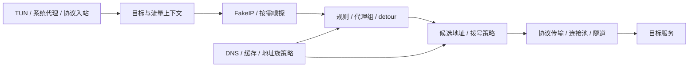

# JiejieBox

基于 [sing-box](https://github.com/SagerNet/sing-box) 持续开发的跨平台代理内核，扩展 XHTTP、Mieru、VLESS 加密与 Native Naive，优化 DNS、双栈拨号、链式代理、网络恢复及资源管理，并提供配套桌面端和移动端集成。

[下载](https://github.com/Piggy-Cat-bit-shadow/JiejieBox/releases) · [更新日志](CHANGELOG.md) · [Android 客户端](https://github.com/Piggy-Cat-bit-shadow/satelite-one) · [配置文档](docs/configuration) · [问题反馈](https://github.com/Piggy-Cat-bit-shadow/JiejieBox/issues)

## 客户端与命令行内核

| 平台 | 获取方式 |
| --- | --- |
| **Windows x64** | Release 提供桌面客户端安装包和独立 `windows-amd64` 命令行核心。 |
| **Android arm64** | 使用 [satelite-one 客户端](https://github.com/Piggy-Cat-bit-shadow/satelite-one)。本仓库的 `android-arm64` 附件为 AAR 开发集成包。 |
| **Linux amd64** | Release 提供命令行核心；部署见 [Linux 服务端文档](docs/JIEJIE-SERVER.md)。 |
| **macOS arm64** | Release 提供命令行核心；参见 [macOS 运行说明](docs/JIEJIE-MACOS-CLIENT.md)。GUI 与 TestFlight 构建见 [Apple 发布说明](docs/APPLE-BETA-RELEASE.md)。 |
| **iOS / iPadOS arm64** | Release 提供完整未签名 IPA，支持自行签名安装；TestFlight 见 [Windows 构建 → Mac 签名与上传指南](docs/APPLE-BETA-RELEASE.md)。 |
| **Apple 开发集成** | Release 提供 Libbox；iOS 与 macOS 客户端使用固定源码和经过来源校验的库。 |

按 Release 附件选择平台与架构，并核对 `SHA256SUMS`。Android AAR 不可直接作为 APK 安装，iOS 未签名 IPA 需自行签名；macOS DMG 是否提供以相应版本附件为准。

**Apple TestFlight 构建**：在 Windows 发起 Apple Actions，Mac 通过 [`scripts/publish-apple-beta.sh`](scripts/publish-apple-beta.sh) 跟随指定运行，获取同次 Libbox 并完成签名、归档与上传。支持 iOS、macOS 或同时构建；Mac 需配置 Apple 签名与 App Store Connect。具体参数和操作步骤见 [TestFlight 构建说明](docs/APPLE-BETA-RELEASE.md)。

## 架构与协议协作

JiejieBox 的协议实现接入共同的 DNS、拨号、路由、平台状态和资源管理接口。规则选择、物理连接、协议会话与系统隧道各自保留明确职责，使双栈、代理链、复用和网络恢复能够跨组件协作。

图中表示主要协作关系，实际解析位置与数据路径由入口、DNS 归属和所选协议决定。

| 公共机制 | 跨协议作用 |
| --- | --- |
| **DNS 与 Dialer** | 统一解析策略、地址族候选、接口绑定、路由标记、namespace、取消和超时；协议适配层将这些条件传到实际 socket。 |
| **Router 与路径校验** | 区分代理组的控制选择与真实网络跳点，检查依赖、循环和能力要求；逐流传递目标、候选及业务类别。 |
| **Scope 与 RuntimeCoordinator** | 明确启动、关闭和异步任务所有权，利用网络代次与重建租约隔离迟到结果，协调切网及恢复。 |
| **ReferenceManager 与 Power Governor** | 按资源能力清理空闲连接、退役可疑旧池和处理内存压力；平台报告网络、休眠与内存事实，由核心执行相应策略。 |
| **FailureFacts 与流量类别** | 协议上报错误阶段和来源，代理组据此决定重试与健康状态；`traffic_class` 同时服务于上传调度和 NE 创建准入。 |
| **Buffer、MTU 与数据交接** | 将缓冲区容量、所有权、半关闭及下层隧道容量贯通传输包装和 TUN 回包，减少复制并保持失败回退与释放责任。 |

公共管理通过协议提供的能力接口执行。XHTTP 的 XMUX、Mieru 的 SDK Runtime、AnyTLS Session、Cronet Engine 和 MASQUE 隧道保留各自的复用与失败状态；普通空闲清理、唤醒后停止接收新流和网络重建分别处理。

完整的调用关系、协议适配与链路案例见 [架构与网络链路优化](docs/ARCHITECTURE-AND-NETWORK-PATH.md)。

## 协议与网络能力

### XHTTP

- 支持 `packet-up`、`stream-up`、`stream-one`、`auto` 四种客户端模式，覆盖 HTTP/1.1、HTTP/2 和 HTTP/3。
- 支持 X-Padding、上传分块与 XMUX 连接复用，传递拨号取消和 deadline。
- packet-up 使用有界队列与单一 flusher 聚合写入，保留首包低延迟、顺序、背压及尾部数据完整性。
- 连接池接入网络切换、休眠恢复和空闲清理，处理上传拒绝、H3 故障与关闭边界。

VLESS 将空闲清理和复用退役请求传递给 XHTTP，再由 XMUX 区分空闲物理连接与活跃逻辑流：内存整理只释放空闲项，唤醒后的可疑连接停止承接新流，已有流按契约排空。单流重置保留其错误范围，避免误将其他复用流一并关闭。上传聚合与 HTTP 传输的连接数、取消和响应消费共同维护有界背压。

历史 TLS/H2 受控测试，服务端为 Xray v26.9.30：

| 指标 | 早期实现 | 优化后 JiejieBox | Xray 参考客户端 |
| --- | ---: | ---: | ---: |
| packet-up 单流上传 | 2.12 MB/s | **26.8 MB/s** | 22.9 MB/s |
| 建连 p99 | 31.7 ms | **约 4.3 ms** | 约 4.35 ms |

该组上传约为早期实现的 12.6 倍；另一轮 RTT 扫描中，100 ms 下双方为 7.88 / 7.80 MB/s，200 ms 下为 3.92 / 4.04 MB/s。完整条件、后续混合负载与实现说明见 [性能对照](docs/PERFORMANCE-COMPARISONS.md#2-xhttp与-xray-的实现速度对比)和 [XHTTP 模块](KNOWLEDGE/modules/xhttp-client-transport.md)。

### Mieru

- 基于官方 SDK 提供客户端和服务端，支持 TCP、UDP、端口范围及协议参数。
- DNS、双栈候选、接口绑定、路由标记和 socket 创建接入共享内核，保留 SDK 的协议与会话机制。
- 可选启用 TCP/UDP 传输回退，包含冷却、退避、按需恢复探测和网络代次隔离；传输偏好变化只影响新会话。
- 统一监听器、在途连接与 SDK Runtime 的清理责任，处理部分启动失败和切网后的迟到结果。
- 通过类型化失败信息区分目标拒绝、本地错误、调用方取消与代理通路故障，供代理组决定重试和健康状态。

SDK 的 listener/dialer 桥接保留内核的 socket 策略，适配层在自己拥有的拨号边界记录错误，避免 SDK 文本包装丢失类型后无法判断失败来源。启用回退时，TCP 与 UDP 分别持有运行时和会话，选择器管理偏好与探测；接口变化通过新运行时启动、代次交接和旧资源清理完成重建，防止迟到拨号修改新网络状态。

历史实现对照：

| 场景 | 对官方同版本客户端 | 对 Mihomo 产品 |
| --- | ---: | ---: |
| 低复用 TCP 下载 | +10.2% | 1.07× |
| 低复用 TCP 上传 | −6.1% | 0.95× |
| UDP underlay 上传 | +16.0% | 1.27× |

官方对照使用 SDK v3.38.1，Mihomo v1.19.32 使用 SDK v3.38.0。1200 字节 UoT 帧微基准中，适配层写入为 118.8 ns/op，官方包装路径为 666.1 ns/op；分配量为 64 / 1280 B/op，读取分配次数为 0 / 2。当前 SDK 已升级至 v3.39.0，历史矩阵尚未按新 SDK 全量重测。完整结果见 [Mieru 性能对照](docs/PERFORMANCE-COMPARISONS.md#3-mieru官方-sdk官方客户端与-mihomo-对照)与 [集成说明](KNOWLEDGE/modules/mieru.md)。

### REALITY 与 VLESS

- REALITY 支持混合密钥交换、可配置 `key_share`，以及实际作用于握手的 TCP 分片和 TLS record 分片。
- 提供 VLESS 客户端应用层后量子加密，处理握手取消、帧边界与重密钥。
- 对不支持的指纹与 ECH 组合明确报错，校验 Vision 依赖的接口契约。

REALITY 的密钥份额、Verifier 与 uTLS 配置克隆需要贯通真实握手；VLESS 应用层加密、Vision 与 TLS 则分别维护自己的帧和数据状态。项目核对连接包装后的缓冲区交接、半关闭及专用写入能力，并对 Vision 使用的依赖内部布局设置兼容检查，避免升级后编译通过却破坏数据路径。

XHTTP 和 VLESS 加密扩展以客户端为主，不包含对应服务端实现。参见 [配置示例](docs/FORK-CONFIGURATION.md)及 [传输模块](KNOWLEDGE/modules/xhttp-client-transport.md)。

### Native Naive 与 HTTP 服务端

- 原生 Naive 入站支持认证 CONNECT、padding、UoT v1/v2、伪装响应和认证前资源限制。
- 对 UoT 非固定目标会话实施逐数据报目标检查，保留认证身份与路由上下文。
- HTTP/2、HTTP/3 提供并发流、流控窗口与请求阶段限制，处理非法 CONNECT、短写和关闭边界。
- 客户端使用自定义 Cronet fork，保留 host dialer、可配置窗口及可选 H3→H2 回退。
- Chromium 154.0.8037.49 已吸收 NaiveProxy patch5 相关证书封锁、QUIC 窗口与自动调节修复，并修复 Linux DNS 桥的匿名 socketpair 回复。

Cronet 通过 host dialer 接入本项目的服务器解析和双栈策略，Go 与原生侧共同处理连接、异步缓冲区及回调生命周期。出站完成 CONNECT 握手后再返回连接，并将可确定的认证或拨号失败传给代理组；H3→H2 回退区分传输故障、HTTP 响应与调用方取消。服务端 padding 的就地构造与 UoT 目标检查分别遵守帧容量和逐包目标语义。

能力由实际构建标签决定：Linux 默认服务端档包含 Naive 入站，未启用 Cronet 出站；Windows 使用 `with_purego` 加载原生库。参见 [Naive 说明](docs/naive.md)、[HTTP 传输模块](KNOWLEDGE/modules/naive-http-transport.md)和 [Cronet 修复记录](KNOWLEDGE/reports/release/cronet-patch5-linux-dns-2026-11-05.md)。

### MASQUE / CONNECT-IP

- 完善 CONNECT、CONNECT-UDP 与 CONNECT-IP 数据面，处理地址分配、路由通告、DNS_ASSIGN 和 PREF64。
- 区分连接代理服务器的 Bootstrap DNS 与隧道内部解析，支持已有 H3 连接上的 DoH 及解析状态快照。
- 在 QUIC 握手阶段竞争候选，回收落败连接；H3 建连保留独立尝试窗口，为 UDP 黑洞下的 H2 回退预留时间。
- 优化 DATAGRAM 所有权与批处理，限制 Capsule 长度和条目数量；按已知下层容量处理包大小与 ICMP Packet Too Big。

CONNECT-IP 将远端分配的地址、路由与内部 DNS 同本地 endpoint/TUN 状态衔接；Bootstrap DNS 始终负责建立外层连接。数据报在 HTTP/3、QUIC 和 TUN 边界明确转移所有权，部分发送成功后仅回退或释放仍由调用方持有的部分。H3 故障判断区分 QUIC 建连失败和 CONNECT 响应缓慢，避免一次应用层延迟影响后续传输选择。

详见 [MASQUE 使用说明](docs/masque.md)和 [CONNECT-IP 模块](KNOWLEDGE/modules/masque-connectip.md)。

### AnyTLS、TLS 与传统代理

- AnyTLS 将 session 复用、开流、空闲退役与网络变化接入共享生命周期；帧头使用缓冲区预留空间，session 级写入保持协议顺序。
- 共享 TLS dialer 统一传递握手取消、错误和流量类别；在 NE 模式与 AnyTLS 共用创建许可，使 Trojan、VLESS/VMess 及相关 HTTP/DNS 传输使用一致的准入策略。
- ShadowTLS 限制认证前读取，清理失败的握手目标连接，并保留包装后所需的复制与关闭能力。
- SOCKS/HTTP CONNECT 保留目标解析归属、首包缓存和半关闭；SOCKS5 可选 TCP 预连接池有界运行，UDP ASSOCIATE 与 UoT 使用各自路径。
- Shadowsocks、Snell 等既有数据面结合 MTU、加密帧和缓冲区容量优化复制；协议需要保留的读写隔离按实际所有权处理。

公共 TLS 的创建治理见 [资源准入模块](KNOWLEDGE/modules/resource-admission.md)，协议包装和复制约束见 [缓冲区所有权](KNOWLEDGE/modules/buffer-ownership.md)。

### Hysteria2、TUIC 与网络端点

- Hysteria2/TUIC 通过 sing-quic 与 quic-go fork 衔接数据报所有权、UDP socket、会话复用和网络变化，减少载荷复制及接收队列对大缓冲区的长期引用。
- 嵌套代理时，将已知下层容量传到 QUIC 包大小约束；Hysteria2 的硬上限在 ChromeParrot 指纹覆盖后应用，TUIC 同样区分初始包偏好与持续约束。
- WireGuard 协调暂停、重新绑定与关闭，设备发布时继承已经生效的暂停状态；避免在睡眠或停止后残留底层 bind。
- MASQUE、WireGuard、Tailscale、OpenVPN 和 OpenConnect 等 endpoint 按自身能力与 HostPort/TUN 协作，使端点本地流量使用相应地址族和路由上下文。

隧道包大小、重建时机和平台接口分别按协议处理。详见 [MTU 与缓冲区几何](KNOWLEDGE/modules/mtu-and-geometry.md)、[endpoint 数据面](KNOWLEDGE/modules/masque-connectip.md)和 [生命周期](KNOWLEDGE/modules/core-lifecycle-runtime.md)。

### DNS 与 FakeIP

- **多上游分组**：`stable`、`fastest`、`parallel` 支持不同选择策略，协调冷启动竞选和失败恢复，控制请求放大。
- **查询与缓存协调**：相同查询并发去重，过期缓存的后台刷新按键合并；缓存提交检查网络与策略代次。
- **NXDOMAIN 负缓存**：满足单问题、有效 SOA、非零负 TTL 等条件时，复用同一域名不存在的结论，减少 A/AAAA/HTTPS/SVCB 重复请求；重建请求 ID、问题和剩余 TTL。
- **本地广告拦截**：DNS `adblock` 动作按规则直接返回带 SOA 的 NXDOMAIN，不访问上游；与上游负缓存分别管理。
- **FakeIP 所有权**：记录签发、退役与持久化状态，避免旧虚拟地址被当作真实目标；异步劫持传递已解析消息，避免读取复用后的收包缓冲区。
- **异步建连**：DNS 冷连接建立移出调用方收包路径，打包前复制消息，避免并发修改共享对象。

配置和边界见 [NXDOMAIN](docs/DNS-NXDOMAIN.md)、[adblock](KNOWLEDGE/modules/dns-adblock-action.md)与 [DNS 模块](KNOWLEDGE/modules/dns-demand.md)。

### 双栈拨号与链式代理

- A/AAAA 增量结果可直接进入连接竞争；候选按地址族交错启动，快速失败时推进其他候选，严格单地址族策略同样约束字面地址。
- selector、URLTest 和 loadbalance 传递完整候选列表与网络策略，避免代理组包装丢失双栈能力。
- 区分本机出口能力与远端代理的目标可达性；网络切换后的旧查询、落败连接和迟到结果按代次处理。
- `detour` 组合多跳出站，启动时检查缺失引用、循环及能力要求；路径预览不拨号、不解析，也不消耗轮询位置。
- 代理服务器与最终目标的 DNS 分别归属；支持的 SOCKS/HTTP 出站可显式设置 `destination_dns_ownership`，保持默认远端解析语义。
- 显式开启组故障切换后，嵌套代理组共享逐流重试预算，按错误来源决定是否尝试备选节点。
- 链式包装保留半关闭、批处理和复制能力；已知下层隧道容量时传递相应包大小约束。

例如 `exit.detour = entry` 表示流量先经过 `entry`，再到达 `exit`。配置、解析归属与失败边界见 [扩展配置](docs/FORK-CONFIGURATION.md)、[路径选择](KNOWLEDGE/modules/path-selection-validation.md)和 [双栈审计](KNOWLEDGE/reports/core/DUAL_STACK_CROSS_COMPONENT_ARCHITECTURE_AUDIT_2026-10-20.md)。

### 自动测速与负载均衡

- `urltest` 先预热再测后续请求延迟，支持 `expected_status` 表达式，如 `204`、`200-299`、`200/204/301-399`。
- `loadbalance` 支持 `round_robin`、`consistent_hashing` 和 `sticky_sessions`，按 TCP 连接或 UDP 会话选择成员。
- 相同测试条件可共享健康记录，手动测速显示与自动选路状态分别管理。
- 透明 selector/URLTest 可保留底层快速路径资格；组级 `fast_path: false` 优先拒绝，具有重试职责的组不作为透明包装。

详见 [负载均衡与故障重试](docs/FORK-CONFIGURATION.md#负载均衡与故障重试)和 [Fast Path 策略](KNOWLEDGE/modules/fast-path-group-policy.md)。

## iOS 本地回环

**开启路径：更多 → 连接行为 → 配置覆盖 → 本地签名回环。** iPad 在“配置覆盖”中查找同名开关。默认关闭，开启并重载后向本次 TUN 注入 `10.7.0.1`，用于本机回环连接。

**当前仍存在兼容性问题**：根据现有真机反馈，WLOC 的开发者模式虚拟定位可正常使用，但使用本项目回环进行 **SideStore 续签仍有问题**。续签时请切换至 **LocalDevVPN** 建立本地隧道，再回到 SideStore 刷新应用，操作参见 [SideStore 官方指南](https://docs.sidestore.io/docs/installation/install)。

上述结果仅对应已反馈的设备与使用场景。默认 `go` 栈支持 TCP、UDP、ICMPv4/v6 反射；其他显式栈尚无完整同等实现。配置与排障见 [本地回环说明](docs/IOS-SELFSIGN-AND-LOOPBACK.md#打开本地签名回环)。

## 生命周期与资源优化

### 网络恢复与后台管理

- 切网时按资源契约退役旧状态；休眠唤醒后区分 Keep、Suspect、Retire，停止向可疑旧池分配新流，并允许已有工作排空。
- 暂停非必要 DNS、规则集和 Dashboard 后台刷新，保留首次初始化及必要恢复工作。
- 空闲清理、系统压力与紧急回收共用协调路径，按过期缓存、空闲池、runtime 回收逐级处理，并根据收益提前停止。
- 区分 Apple 进程 footprint 与 Go 内存软限制，Android 分级 trim 不将界面隐藏直接视为内存危机。

详见 [生命周期](KNOWLEDGE/modules/core-lifecycle-runtime.md)、[移动端电源管理](KNOWLEDGE/modules/power-mobile-lifecycle.md)及 [内存回收设计](docs/FAST-PATH-AND-MEMORY.md)。

### iOS 高成本创建准入

`resourceguard` 在 Network Extension 模式复用 OOMKiller 的压力状态，为 AnyTLS TCP/UoT 和共享 TLS 握手限制创建并发、队列和等待时间。正常态默认并发 32、队列 256，交互流量另有 4 个预留额度；Armed/Critical 状态逐级收紧。

流量类别沿拨号 Context 传递；嵌套 TLS、AnyTLS 和 detour 共用已持许可标记，避免重复领取。压力计划按版本发布，防止陈旧观察覆盖新状态或重复触发回收。诊断记录请求、排队、拒绝、取消与在途计数。

该机制限制创建阶段，默认不作用于非 NE 平台。实现与已知限制见 [资源准入模块](KNOWLEDGE/modules/resource-admission.md)。

## 端到端网络链路优化

| 链路阶段 | 主要改造 |
| --- | --- |
| **入口与收包** | TUN 将 DNS 劫持、FakeIP 和流量预判按明确顺序处理，合并栈启动前的重置并衔接启动后事件；Mixed 复用读取器区分 HTTP/SOCKS，保持认证与首包数据。 |
| **目标识别与嗅探** | HTTP/TLS 提前排除不匹配输入；TLS 只提取所需 ClientHello，QUIC 后续分片读取有界。可信 FakeIP 域名满足条件时减少额外等待，保留首包重放和借用缓冲区的生命周期。 |
| **解析与候选构造** | 协调并发 DNS 查询、缓存和增量 A/AAAA；按流捕获有效地址族策略，区分本地出口能力与代理端目标能力，将迟到候选和结果限定在所属网络代次。 |
| **规则与代理组** | 使用紧凑规则结构和有界扩容，流式加载远程规则；组选择传递完整候选，预览不消耗轮询，同一条流共享嵌套重试预算。 |
| **物理拨号与握手** | 将接口、mark、namespace、截止时间和取消传到实际 socket；回收竞争落败或迟到的连接。TLS/AnyTLS 在 NE 模式复用创建许可，代理拒绝与路径错误分别归因。 |
| **协议传输与上传** | 按协议选择 XMUX、SDK Runtime、TLS/QUIC 会话或 CONNECT；聚合小写入、复用帧头空间、按能力转移数据报。显式上传整形持续控制共享队列，保护交互请求。 |
| **回包、复制与关闭** | TUN 常见回写复用切片，批量发送按已完成部分结算；缓存首包交接、splice 失败回退和 kTLS 尾部交付保持数据完整，半关闭与连接接管沿原资源释放链退出。 |
| **切网与资源回收** | 网络代次隔离旧查询与连接，重建租约限制重复恢复；休眠后的复用退役与普通内存清理分别执行，按收益逐级回收缓存、空闲池和 runtime 页面。 |

**快速路径分层执行。** Linux `auto_redirect` 的 Direct Offload 只有在路由、目标和 socket 选项可保持原有语义时才尝试系统绕行；普通 TUN、系统代理和连接建立后的 splice 各有独立路径。FakeIP、认证、跟踪、业务调度及显式 `fast_path: false` 等要求参与资格判断，不能以旁路授权替代实际数据交付。

**控制面成本与逐包成本分别优化。** 拨号选项和引用关系尽量在构造或启动阶段整理，逐流处理地址候选、选路和握手，逐包路径集中于必要的帧处理、复制和所有权转移。规则加载累计分配、连接创建峰值、稳态数据吞吐与后台活动分别测量。

设计与调用链见 [架构与网络链路优化](docs/ARCHITECTURE-AND-NETWORK-PATH.md)、[数据路径模块](KNOWLEDGE/modules/data-path-optimization.md)和 [Fast Path 设计](docs/FAST-PATH-AND-MEMORY.md)，配置见 [扩展配置示例](docs/FORK-CONFIGURATION.md)。

## 性能与内存对照

以下为历史基准与受控实验。表中分别标明负载和测量层级，完整日期、基线、对照及复测方法见 [性能专页](docs/PERFORMANCE-COMPARISONS.md)。

| 场景 | 优化前 | 优化后 | 条件 |
| --- | ---: | ---: | --- |
| 上传拥塞下交互消息 p99 | 146 ms | 9 ms | 4 条普通流竞争约 2 MB/s FIFO，按容量 85% 持续整形 |
| 持续上传后首条交互消息 p50 | 127 ms | 2 ms | 同组整形实验 |
| 每流活跃缓冲区驻留 heap | 64.1 KiB | 32.1 KiB | 默认与 low-memory 构建的缓冲区基准 |
| 百万域名加载累计分配 | 42.5 MiB | 20.6 MiB | 同机同样例；加载 GC 由 10 次降至 5 次 |
| 10 万域名加载累计分配 | 4.1 MiB | 2.9 MiB | 有界几何扩容 |
| 无缓存远程 SRS 加载累计分配 | 21,229,120 B | 约 125 KB | 有效规则附加 4 MiB 非压缩尾部，保留完整性检查 |
| TUN 单包回写 | 约 236–238 ns、72 B、2 次分配 | 约 156 ns、0 B、0 次分配 | dispatcher + portNAT 微基准 |
| 非 HTTP 输入经过 HTTP 嗅探 | 4,889 B、9 次分配 | 205 B、3 次分配 | DNS-over-stream 样例 |
| CONNECT-UDP 包装边界 | 409–428 ns、1345 B、2 次分配 | 83–85 ns、64 B、1 次分配 | 1200 B 载荷，owned 路径微基准 |
| CONNECT-UDP 实际 quic-go 连接 | 10.6 µs/包 | 9.5 µs/包 | 1000 B、5000 次发送 |

XHTTP 与 Mieru 的实现对照见上方协议章节。各项数据不构成所有网络或当前版本的统一性能保证；吞吐、累计分配、稳态内存与设备 footprint 应分别测量。

## 安全与部署

### TCP 监听默认安全

Linux 普通入站在未显式启用 `tcp_multi_path` 时使用普通 TCP；Clash API、V2Ray API、Debug HTTP、libbox pprof 等管理入口同样显式关闭默认 MPTCP，减少 Go 默认设置导致的意外暴露。

这一措施缓解 CVE-2026-98432 已公开利用路径的攻击面。底层缺陷位于 Linux IPv4 TCP，系统仍需安装内核安全补丁；`tcp_multi_path: true` 保留主动启用能力。详见 [MPTCP 安全说明](docs/SECURITY-MPTCP.md)。

### 服务端与桌面客户端

- Naive、HTTP 和 MASQUE 的认证、伪装响应及隧道建立分别校验；提供连接数、请求头、并发流和窗口等资源限制。
- UoT 非固定目标会话逐包执行目标访问检查；具体准入由规则顺序与配置决定。
- Windows 守护进程校验调用进程、安装位置、角色和签名者，按安装身份隔离服务状态、应用数据与卸载清理。
- 配套客户端区分订阅正文与用量信息，支持 `Subscription-Userinfo`，维护 Dashboard 集成。

部署与本地服务边界见 [服务端说明](docs/JIEJIE-SERVER.md)和 [Windows 守护进程模块](KNOWLEDGE/modules/windows-daemon-security.md)。

## 配置、依赖与验证

常规配置以已纳入的 sing-box `v1.15.0-alpha.13` 为参考，后续修复按补丁语义选择性适配。当前 Naive 引擎为 Chromium `154.0.8037.49`，包含 NaiveProxy patch5 相关修复；Mieru SDK 为 `v3.39.0`。扩展字段和实际协议能力受平台、构建标签及客户端版本约束。

项目维护 sing、sing-tun、sing-quic、quic-go、uTLS 和 cronet-go 等依赖 fork。根模块、独立测试模块、客户端 gitlink、原生库 provenance 与 source-lock 共同固定构建来源；源码版本、构建成功和已发布附件分别记录。

测试覆盖协议互通、真实载荷、网络切换、取消与关闭、缓冲区所有权、配置校验及故障注入。测试结果按提交、平台和场景记录，设备行为与性能实验保留各自验证范围。参见 [验收索引](KNOWLEDGE/ACCEPTANCE.md)、[关联仓库](FORK_REPOSITORIES.md)和 [依赖整合](docs/fork/UPSTREAM-DEPENDENCY-INTEGRATION.md)。

## 文档

- **配置与使用**：[配置参考](docs/configuration) · [扩展配置示例](docs/FORK-CONFIGURATION.md) · [NXDOMAIN](docs/DNS-NXDOMAIN.md) · [本地回环](docs/IOS-SELFSIGN-AND-LOOPBACK.md#打开本地签名回环)
- **构建与发布**：[构建档位](docs/BUILD-PROFILES.md) · [Apple TestFlight](docs/APPLE-BETA-RELEASE.md) · [更新日志](CHANGELOG.md)
- **性能与设计**：[架构与网络链路](docs/ARCHITECTURE-AND-NETWORK-PATH.md) · [性能对照](docs/PERFORMANCE-COMPARISONS.md) · [性能参数](KNOWLEDGE/PERFORMANCE-FACTORS.md) · [Fast Path 与内存管理](docs/FAST-PATH-AND-MEMORY.md) · [工程架构评估](KNOWLEDGE/reports/core/JiejieBox_工程架构与改造最终评估报告_2026-11-01.md)
- **开发维护**：[Fork 差异](docs/FORK-DIFF.md) · [知识库](KNOWLEDGE/README.md) · [任务索引](KNOWLEDGE/INDEX.md) · [维护指引](KNOWLEDGE/REFRESH.md)

开发及 AI 助手从 [AGENTS.md](AGENTS.md) 进入，先确认知识库基线与 Git 增量，再按任务查阅模块。

## 致谢与许可

感谢 [SagerNet/sing-box](https://github.com/SagerNet/sing-box) 及相关上游项目和贡献者。本项目采用 [GNU GPL v3.0 或更新版本](LICENSE)。
