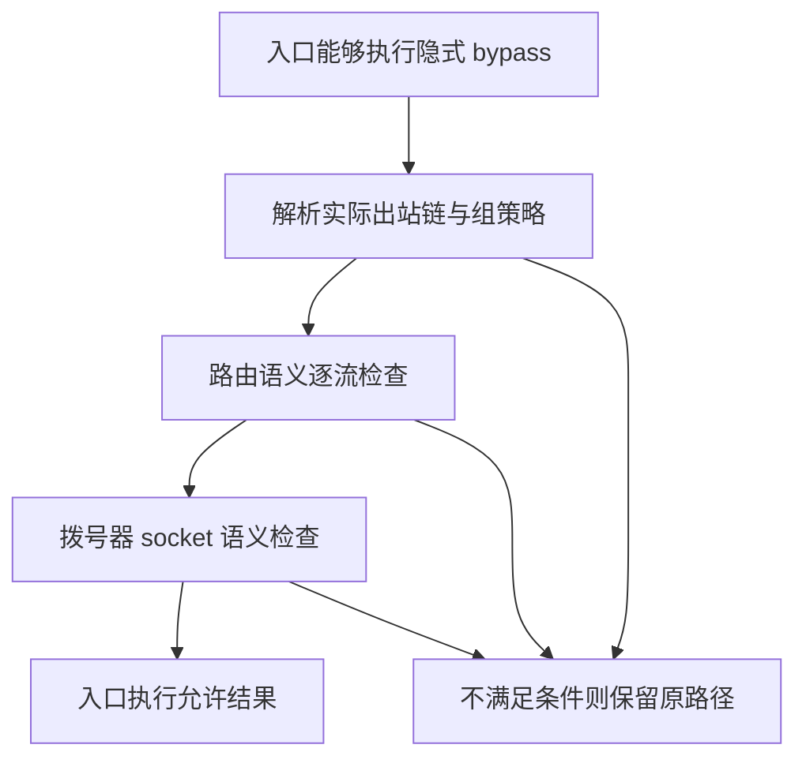

# Fast Path 与内存管理：设计、执行路径和配置边界

本文结合当前源码与历史工程记录，说明两项跨组件改造。Fast Path 不是一个布尔加速开关，内存管理也不是定时调用一次 GC。下文区分策略、数据实际经过的位置，以及关闭 / 网络变化时谁拥有资源。

## Fast Path 的四个层次

| 层次 | 做什么 | 与其他层的关系 |
| --- | --- | --- |
| 地址集合 / 平台路由 | 根据配置的路由地址集合和平台能力决定哪些流量进入内核 | 发生在完整用户态路由前，不能假定已经执行了所有域名规则或统计。 |
| 隐式 Direct Fast Path | 路由完成必要判断后，符合条件的流交给入口的系统路径 | 要求入口实际能执行 bypass；与显式 `action: bypass` 分开。 |
| 接管、splice / 下层复制 | 选路后在连接能力允许时交给相应复制路径 | 与是否绕过路由、是否跳过统计不是同一个决定。 |
| 用户态复制优化 | 首包所有权、缓冲区尺寸、批量和数据报所有权等 | 当不能绕行或接管时，这些优化仍可能减少复制和分配。 |

### 由实际消费者决定是否评估隐式绕行

`adapter.InboundContext.ConsumesBypassVerdict` 由入口报告。当前相应消费路径是 sing-tun nfqueue / `auto_redirect`：它能将允许结果作用到系统转发。普通 Go / system 等 TUN 处理路径不会因为收到了相同 verdict 就自动绕过用户态。

因此 `route.preMatchFlow` 只在消费者具备能力时评估隐式 Direct Fast Path。判断依据是运行模式，不是简单的 Linux / Darwin 宏；同一 Linux 二进制也可运行普通 TUN。显式 bypass 规则和路由地址集合有自己的操作语义，不由这一优化替用户改写。

### 两道独立判断



**路由层**处理 FakeIP、嗅探、候选列表、目标重写、规则要求和统计消费者。**拨号层**处理接口绑定、地址绑定、mark、namespace、TCP / UDP socket 选项及有效地址族策略。必须同时满足条件，不能互相代替。

### 按真实流解释选项，而不是要求配置为空

`NativeBypassSemantics` 在构造拨号器时分类选项，生成紧凑的 `SocketSemantics`。后续逐流检查使用预计算结果，不在每个数据包上反射配置。

- TCP 专用选项仅影响 TCP，UDP 专用选项仅影响 UDP。
- 只有域名解析时才使用的 resolver 配置，不应让不解析的字面地址流自动失去资格。
- 严格地址族策略仍约束字面地址；策略可能继承自全局 DNS，不只是出站显式设置的字段。
- 全局绑定 / mark / 网络策略、本机自身地址及本地地址族能力也需与正常拨号一致。
- 未构造的 profile 拒绝；未分类的新字段即使当前是零值也拒绝，避免零值本身具有行为的字段被漏掉。
- 字段覆盖测试随着选项结构检查分类表，防止新增选项静默改变绕行语义。

### 为什么某条流不能绕行

源码提供结构化拒绝原因，不将所有情况压成一个 false：

| 检查类别 | 典型原因 |
| --- | --- |
| 目标身份 | 域名、FakeIP、嗅探得到的域名、已解析候选、规则改写或记录了原目标。 |
| UDP 行为 | 逐包目标 UoT、connected UDP、自定义超时、域名 unmapping。 |
| 网络与 TLS | 接口 / 回退策略、TLS 分片、record fragment、spoof。 |
| 必须保留的观察 | 流量 tracker、运行中的功耗记录、无法证明的进程信息。 |
| 出站链 | 不透明组、不能绕行的叶子、不能由系统 connect 重现的拨号语义。 |

这使优化能够解释“为什么没生效”，也避免靠关闭统计或跳过用户策略制造速度优势。

### 组策略与透明链的演进

`fast_path` 只承载逻辑组意图，写在 selector / urltest 上。按从外到内的链顺序读取第一个显式策略；没有策略时，纯透明选择层通往真正 direct 的链可以保留其固有授权。loadbalance 等可能拥有重试或其他流语义的对象不被当作透明包装。

- `false` 必须能关闭本来具有固有授权的 direct 透明链。
- `true` 只是请求考虑，仍需通过所有资格检查，不能使代理叶子获得 direct 能力。
- 当前真实实现中，不应把 true 与未配置宣传为普遍可观察的提速差别；现有生产形态的差异由等价性测试约束。
- 分组名字不再授予快速路径权限。旧 AI 标签回退无法改变现有生产判定，已被移除；`traffic_class` 的业务分类继续独立工作。
- 只在流建立时解析策略，不写成节点全局状态，也不放入逐包路径。

配置示例及平台条件见 [扩展字段指南](FORK-CONFIGURATION.md#fast-path-组策略)。

### 接管成功、真正复制与连接存活分别观察

连接接管被接受，不等于已经执行内核 `splice`。具体复制方式还取决于连接能力、操作系统与底层实现。建立 splice 管道失败时必须明确回到用户态，不能提前声称接管后停止复制。

交接后没有普通复制循环的 Direct TCP 流，不能依靠复制循环退出启动半关闭观察；额外启动读取者又会争抢字节。当前路径使用既有 TCP keepalive 状态机观察存活，并走原有 detach / release / tracker 关闭链。默认参数为静默 2 分钟、探测间隔 30 秒、3 次未答；这是配置到该路径的时间参数，不是对所有网络的绝对回收时限承诺。

源码：[组策略](../route/fast_path.go)、[逐流资格](../route/route.go)、[拒绝原因](../route/bypass_verdict.go)、[拨号语义](../common/dialer/profile.go)、[接管存活](../route/splice.go)。

## 内存管理的分层设计

### 不把 RSS、Go Heap 和系统可用内存混为一个数

尤其在 Apple 平台，进程 footprint 包含 Go、C / Swift 及系统分配；Go runtime 的软限制只约束它所管理的部分。两套信号互补，不能用 GOMEMLIMIT 宣称整个进程一定不超预算。

采样区分“平台报告可用内存为零”和“平台根本不支持这个测量”。只有平台声明该数据有效时才参与相应判断，避免不支持 API 被当成永久内存危机。Network Extension 使用统一的平台策略生成软限制、安全余量和采样设置；fallback 预算不是 Apple 对所有设备的固定额度。

### 从成本低的层开始，达到收益就停止

| 层次 | 动作 | 为什么不立即做下一层 |
| --- | --- | --- |
| L1 | 清理过期缓存 | 不关闭连接，保留仍有用的缓存和复用状态。 |
| L2 | 释放空闲连接池 | 下一次需求可能重新握手，仅在 L1 收益不足时付出成本。 |
| L3 | 有条件的强制 GC / scavenge | 只有前两层收益不足，且压力或 runtime 可回收页面提供理由时执行。 |
| 紧急路径 | 按当前条件执行网络释放 / 重置，再完成相应报告和 runtime 回收 | 只属于紧急回收，不混入普通整理。 |

各层相对同一次起始 footprint 测量收益；当前空闲收益门槛为 512 KiB，达到即停。下次整理仍从便宜的 L1 开始，不因上次曾升级就永久从 GC 开始。低收益进入冷却，避免稳定内存占用下每秒反复强制 GC。

### 三种请求，共用一个执行器

请求来源为闲时机会、系统压力和阈值 / 增长率危机，优先级为 crisis > pressure > idle。

- 同时最多执行一项回收；只保留一个待执行请求，更紧急的请求可替换它。
- 不在连接池遍历一半时强行中断当前动作；普通回收在层与层之间发现紧急请求时让出执行器。
- Darwin 压力通知执行其压力路径，不因一个系统级通知直接断定本进程网络已坏。
- 普通 `TrimMemory` 与破坏性 `ReleaseMemory` 对共享连接资源串行，避免遍历时底层资源正被另一回收流程重置。
- 昂贵动作不占用状态观察锁，避免 GC 或遥测写入阻塞所有观察者。

### 危机必须在真正重置前再判断一次

紧急请求可能排在普通整理后面，而前一项刚好已经释放足够内存。执行器因此重新采样并检查 armed 条件，再决定是否进行破坏性重置，避免用旧危机重置已经恢复正常的连接。

状态机区分 Normal、Armed、Triggered。Triggered 在回落至 armed 边界以下时退出；不能错误地要求降到更低的 idle resume 水位，否则进程可能长期留在危机状态。report-only 路径跳过网络重置，但保留其报告 / 回收语义，不能把它理解成完全不执行任何工作。

### 关闭和重载是内存管理的一部分

- 关闭时停止接纳新请求，丢弃尚未执行的回收，不在服务已结束后再发起网络重置。
- 等待已经进入的采样、压力回调和回收动作结束，并等待执行器退出。
- 不携带旧实例的临时 pressure intent、强制采样请求或未执行危机。
- 重载携带 Triggered 状态时转为 Armed，使新实例用下一次采样重新决定，而不是错误继承“本轮已经处理过”的结论。
- 紧急回收之后给普通空闲回收冷却，防止刚强制 GC 完就因 footprint 降低再次触发同样工作。

### 休眠后的复用可信度与内存清理分开

复用策略有 Keep、Suspect、Retire 三种结果。当前默认 5 秒达到 suspect、15 秒达到 retire，这是实现策略参数，不是新 JSON 字段。

对于仍有活动流的多路复用连接，直接关闭会打断业务，继续接新流又可能复用已经黑洞的旧路径。支持 drain 的池先停止接纳新工作，让既有工作结束，再释放空闲项；仅支持 idle close 的池执行其既有动作。XHTTP XMUX 是这一差异的重要消费者。

回收遍历覆盖出站、endpoint、DNS transport 和 HTTP client manager；是否执行由实际能力接口决定，不要求每种对象都具有同一套复用操作。HTTP client manager 只提供释放能力时也必须被遍历，不能因断言了更宽的接口而静默漏掉它。

### 通过减少驻留和分配降低回收压力

低内存缓冲区配置、QUIC 接收槽位清空、小型帧尺寸收缩、规则集流式解析与几何扩容、数据包所有权移交和 TUN 单写回路径优化，减少需要 GC 处理的临时对象与被小载荷长期引用的大数组。

这类结构优化与 GC / OOM 策略共同工作。不能把“减少分配”“减少活跃驻留”“释放空闲池”“向 OS 归还页面”四种结果当成同一个指标。历史基准条件见 README 的优化表及对应报告。

源码：[回收执行器与分层](../service/oomkiller/timer.go)、[平台策略](../service/oomkiller/policy.go)、[网络回收接口](../route/network.go)、[复用遍历](../route/reference.go)、[设备策略](../common/power/governor.go)。

## 配置入口与不可配置的内部参数

`fast_path` 示例和默认语义见扩展配置指南。内存服务使用 `services[]` 的 `type: "oom-killer"`；客户端可能自行注入该服务，先确认运行方式，避免重复定义：

```json
{
  "services": [
    {
      "type": "oom-killer",
      "tag": "memory-guard",
      "memory_limit": "128 MiB",
      "safety_margin": "8 MiB",
      "min_interval": "100ms",
      "max_interval": "10s"
    }
  ]
}
```

数值只演示字段位置，不是所有设备的推荐值。采样间隔必须大于零，max 不小于 min。iOS Network Extension 分支使用统一平台策略，不允许配置任意扩大安全采样间隔或缩小其 footprint 余量。

`KillerDisabled` 与 `MemoryLimitOverride` 是 JSON 不可见的内部字段，不能将其名字写成服务开关。分层收益门槛、执行器优先级、复用 freshness 和 `with_low_memory` 也不是任意可写的服务 JSON 子项。准确选项见 [OOM 服务配置结构](../option/oom_killer.go)。

## 版本演进与证据入口

| 正式版本 | 相关演进 |
| --- | --- |
| v0.1.3 | 逐流 Direct Offload 资格、拨号语义预计算及上传路径调度。 |
| v0.1.5 | 休眠状态机、延后后台工作与错峰恢复。 |
| v0.1.6 | 运行时协调、复用边界、HTTP / XHTTP 池回收和接口生命周期整合。 |
| v0.1.8 / v0.1.10 | 组级 fast_path 策略及透明 direct 组授权传递。 |
| v0.1.18 | 实际地址族策略、能力接口与功耗报告等逐流语义收敛。 |
| v0.1.24 | 半关闭观察和交接后的连接存活处理。 |
| v0.1.25 | 实际 bypass 消费者能力、移除无效标签回退、显式 false 优先级，以及统一回收执行器、收益分层、关闭与重载修复。 |

上述为相关主要版本入口，不把所有改动归到一个版本。源码证据与历史运行结果分开：此次为文档核对，没有重新运行各平台 TUN、内核 splice、设备内存压力或全部并发测试。

回归入口包括 [快速路径等价性](../route/fast_path_production_equivalence_test.go)、[策略真值表](../route/fast_path_policy_truth_test.go)、[分层收益](../service/oomkiller/layered_reclaim_test.go)、[执行器](../service/oomkiller/reclaim_executor_test.go) 与 [Triggered 关闭屏障](../service/oomkiller/triggered_stop_test.go)。测试文件存在并不自动等于当前平台的执行结果。
