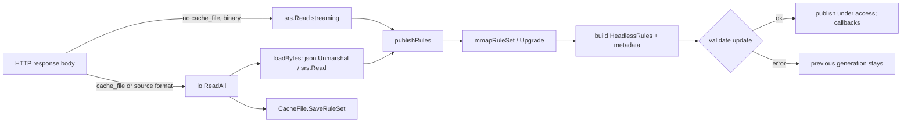

# sing-box audit and construction record — Anywhere round

**Repository:** `github.com/Piggy-Cat-bit-shadow/sing-box`, branch `testing`, worked directly on it.
**Start:** `2ed64483a5b7a326e872fb9c35074748c0c5b97c` (clean worktree, remote `origin/testing` equal).
**Anywhere reference:** `89905e0e3641bcbd958a66fcb6f027a2bdecec90` (see
[`anywhere-deep-study.md`](anywhere-deep-study.md)).
**End:** the code commit `d846fb6c8c9eef71f76242f4ba3e64f776c183c1` plus the documentation commit that
contains this file. `git log --oneline 2ed6448..HEAD` is the authoritative list.

Environment: Windows 10 19044 LTSC, Ryzen 7 4800H (8C/16T), 15.4 GiB, Go 1.25.5 windows/amd64,
CGO disabled. No Apple device, no bash, no C compiler for cgo.

---

## 1. What was asked, and what this round actually did

The brief asked for two equally important deliverables: a source-level study of Anywhere (Report 1) and
real, measured construction in this fork (this report). It also asked for the audit to start from the
real `testing` HEAD rather than an assumed base, and to verify old knowledge instead of trusting it.

Outcome:

1. **One construction shipped:** a remote binary rule-set is now parsed directly from the HTTP response
   stream when there is no `cache_file`, removing a full copy of the download from the load's transient
   heap. Test and before/after allocation evidence are in the commit.
2. **One old record corrected:** `KNOWLEDGE/modules/buffer-ownership.md` says the splice
   `handed=true, n=0` silent-stall defect is "recorded, unfixed". The pinned dependency now fixes it,
   with a regression test and a seam that makes the old bug reproducible. Source wins; no code change
   was made for it (it is not this repository's code).
3. **Several candidates rejected with reasons** (§3.3), rather than patched in for the sake of a diff.

---

## 2. Architecture boundary and authority matrix

The round added no interface, no lifecycle, no goroutine, no timer and no cache. The only authority it
touched is the one that already owned rule-set loading.

| Question | Authority (existing) | What this round did |
|---|---|---|
| Who owns a rule-set's parsed generation? | `RemoteRuleSet.rules` / `LocalRuleSet.rules`, published under `access` and released by `Cleanup`/`Close` | Kept; both loaders now call the single `publishRules` |
| Who validates an update before it becomes live? | `validateRuleSetMetadataUpdate` + `buildRuleSetMetadata` | Kept; called from `publishRules`, so the streaming path cannot skip it |
| Who owns the HTTP response and its cache? | `RemoteRuleSet.fetch`; `adapter.CacheFile` | Kept; the cache path still reads the body into a slice because `CacheFile.SaveRuleSet` takes bytes |
| Who owns the download's bytes? | Previously `fetch` (one slice); now the response body when there is no cache | Narrowed: no cache ⇒ no retained download slice |
| Who owns network generation / cancellation? | `ctx` and `RemoteRuleSet.cancel`; the updater's loop | Untouched |
| Where can a load fail, and what is published? | parse → build → validate → publish; failure leaves the previous generation live | Unchanged; a truncated stream fails in `srs.Read` before `publishRules`, exactly like a truncated body did before |

Data/resource flow of the changed path:

The important boundary is the branch at the top: **the cache needs bytes; parsing does not.** The change
makes that distinction explicit in the code instead of paying for the cache in every configuration.

---

## 3. Findings

### 3.1 Fixed: a remote binary rule-set copied the whole download before parsing

**Reproduction (pre-fix):** a remote `rule_set` with `format: binary` and no `cache_file`; the server
sends a valid `.srs` followed by 4 MiB of non-zlib tail. `fetch` called `io.ReadAll`, so the tail was
copied into the heap even though `srs.Read` never needs it. The new test measured
**21,229,120 bytes allocated**; after the round-1 fix, **108,376 bytes**. Round 2 found that this
version accepted a body truncated after the last rule (the read-all path did not) and added an EOF
drain before publish; the final figure is **119,848 bytes**, and the regression is
[`BUG-02-1`](anywhere-debug-audit.md#bug-02-1).

**Why it matters:** a 10 MiB blocklist costs 10 MiB of avoidable transient on a platform whose budget is
tens of MiB. The parsed form is compact (the census in `rule_set_scale_census_test.go` establishes that
the matcher is built off the stream, without a `[]string` intermediate), so the only large object in
the load was the copy of the download.

**Fix:** `fetch` uses `loadBinaryStream(response.Body)` when `cacheFile == nil` and the format is
binary; otherwise the previous `io.ReadAll` + `loadBytes` path runs unchanged. `loadBytes` was split
into `loadBytes` (decode) and `publishRules` (mmap/upgrade/build/validate/publish), and the streaming
loader shares `publishRules`. It also drains the body to EOF before publishing (added in the debug
round, see below), so a body truncated after the rules fails exactly as it did under `io.ReadAll`.
`cache_file` profiles therefore keep byte-identical behaviour, including the cache write.

**Why this is safe:**

* Same parser (`srs.Read`), same `mmapRuleSet`, same `Upgrade`, same validation, same publish point.
* A malformed stream fails in `srs.Read`; a body truncated after the last rule fails the drain; both
  leave the previous generation live, and the debug round has a red/green test for the second case.
* No new goroutine or lock: the streaming parse and drain run on the same fetch goroutine.
* The cache branch is behaviourally unchanged: `StartContext`'s cache restore and `initialPath` both
  still call `loadBytes`.
* Rollback: revert `d846fb6c8c9` and the debug fix `1f1775e37d2`; the allocation/truncation tests then
  fail, which is the point.

### 3.2 Verified and corrected: the splice silent-stall defect is fixed in the dependency

`KNOWLEDGE/modules/buffer-ownership.md:76-100,166` records the bug ("`handed = true` before `Pipe2`;
`Pipe2` failure returns `handed=true, n=0` with no error") as **unfixed**, and says the one-line fix was
not made. The real code at the pinned dependency
`github.com/Piggy-Cat-bit-shadow/sing v0.9.6-0.20261011105649-bde7ddda55ef` contradicts that:

* `common/bufio/splice_linux.go:43-51` calls `splicePipe2` first and returns `false, 0, err` on failure,
  setting `handed = true` only after the pipe exists.
* The comment at `:22-25` names the old bug and explains the seam.
* `common/bufio/splice_actual_linux_test.go:322-350` is the regression test
  (`TestPipe2SetupFailureFallsBackWhenThePipeCannotBeCreated`), plus a seam guard at `:354-361`.

This is a **stale knowledge finding**, not a repository defect. Per `AGENTS.md` the source wins and the
conflict is recorded here; `KNOWLEDGE/` is not refreshed as part of normal development. The Linux test
cannot run on Windows (`splice_actual_linux_test.go` is Linux-only), so the evidence level is
`VERIFIED_SOURCE` for the fix and `BLOCKED_BY_ENVIRONMENT` for running it here.

### 3.3 Rejected, with reasons (the B/C findings)

| Candidate | Why not merged |
|---|---|
| A `FlowBufferLedger`-style global byte budget | No unbounded data-path queue was found to put in it: the TUN input queue lives in `sing-tun` (dependency), `route/conn.go` uses blocking copies for backpressure, and the fork's caches are bounded (`dns` uses `freelru` with capacity ≥1024). A budget without an enforcing owner would be a number, which is exactly what the Anywhere study warns against (§2). |
| A `SegmentArena`/`PlaintextArena` equivalent | Go's `buf.Buffer` pool already covers short-lived buffers, and this tree's buffer-ownership rules forbid retaining a borrowed view. Adding an arena would create a second ownership authority for no measured win. |
| A `TickScheduler` equivalent | The Go runtime's timer wheel already removes cancelled timers; Anywhere's lazy cancellation deliberately leaves the deadline in the heap (one extra wakeup). The fork's `common/power` + `taskmonitor` already own deferral policy. |
| A `MultiplexerPool` with `minIdleKeep`/`softCapPerKey` | `route/reference.go` is the single idle-reuse/retirement authority (`IdleConnectionReleaser`, `ReuseSuspect`); a second pool would violate the one-authority rule and the inventory test forbids a second `ReuseSuspect` pool (`route/reusable_owner_inventory_test.go`). |
| Caching packed DNS wire bytes to skip `dns.Msg.Copy()` | The copy is what protects the cache from caller mutation; removing it needs an ownership contract across the DNS router API. Promising but not low-risk, and not measured. |
| Removing the per-datagram `buf.NewSize` allocation (`sing/common/bufio.CopyPacket`) | The allocation is real (1 per packet, 64 B in `BenchmarkDirectPacketCopyUserspace`) but it is in the pinned dependency, not this repository. Recorded in the study as a candidate rather than patched around. |
| Lazy/on-demand rule-set loading | Would change startup validation and error semantics (a missing rule-set file is currently reported at start). The memory win applies only to configs that declare unused sets; no evidence they are common. |

---

## 4. Performance comparison

Same machine, same command, same fixture; the fixture is a deterministically built `.srs` (one
`10.0.0.0/8` rule) followed by a 4 MiB tail that is not part of the zlib stream. "Allocated" is
`runtime.MemStats.TotalAlloc` across `fetch`, i.e. the load's own allocation, with the tail allocated
before the measurement (the HTTP handler is in-process).

| Path | Allocated | Test |
|---|---:|---|
| before (`io.ReadAll` + `srs.Read`) | **21,229,120 B** | fails `TestRemoteRuleSetStreamsBinaryWithoutCache` |
| after (stream `srs.Read` + EOF drain) | **119,848 B** | passes, and matches `10.1.2.3` from the streamed rules |

This is a transient/peak result, not a throughput claim: the test asserts the allocation bound, and no
bytes-per-second number is reported for the change. For a real download the wire time dominates; the
win is the heap the process does not have to hold while it parses.

---

## 5. Test and verification record

| Command | Result |
|---|---|
| `go test ./route/rule -count=1` | **PASS**, 2.157 s |
| `go test ./route/rule -run TestRemoteRuleSetStreamsBinaryWithoutCache -v` | **PASS**; logs 119,848 B |
| same test with the fix reverted (temporary checkout) | **FAIL as intended**: 21,229,120 B is not less than 2,097,152 |
| `go test -tags with_low_memory ./route/rule -count=1` | **PASS**, 2.288 s (iOS 16 KiB buffer geometry) |
| `go vet ./route/rule` | clean |
| `gofmt -l route/rule` | clean |
| `go test ./route -count=1 -short` | **PASS**, 61.099 s; `-short` skips `TestBackpressure_KernelGiveUpWindow`, which deliberately observes a kernel give-up for up to **6 minutes** (pre-existing test, unrelated to this change) |
| `go test ./route -count=1 -timeout 12m` (full, including that test) | **PASS**, 421.322 s (the deliberate 6-minute observation plus the rest of the suite) |
| `go test -tags "$(go run ./cmd/internal/appletags -platform ios)" ./route/rule` | **BLOCKED_BY_ENVIRONMENT** on Windows: the canonical Apple set carries `tfogo_checklinkname0`+`badlinkname`, and the linker rejects `tfo-go`'s `net.(*netFD).init` reference here. The tag that matters for this change (`with_low_memory`) passes; the full canonical gate is a Linux/macOS job. |
| `go test -race ./route/rule` | **BLOCKED_BY_ENVIRONMENT** — cgo disabled, no mingw-w64 gcc; `clang` here targets MSVC and rejects `-mthreads` |
| `scripts/ci/test-low-memory.sh` | **NOT_RUN** — needs bash, absent; the equivalent `-tags with_low_memory` package test was run, but the script's Apple-tag assertions were not |
| Apple build (`cmd/internal/appletags -platform ios` + `go build`) | **NOT_RUN** — requires the Apple SDK/cgo toolchain, which this Windows host does not have |
| `phys_footprint` / device memory | **NOT_RUN** — no Apple device; no claim is made |

`route` itself is green in both modes; the only reason that package takes minutes is
`TestBackpressure_KernelGiveUpWindow`'s deliberate six-minute observation. The affected package
(`route/rule`) and the streaming test are green, and the full `route` suite passes as recorded above.

---

## 6. Residual risks and what is not verified

* **No device measurement.** The change is justified by allocation accounting and semantics; it is not
  a measured `phys_footprint` improvement on iOS. The iOS build/run is `NOT_RUN`.
* **Cache-less only.** Profiles with `cache_file` keep the old peak; changing that requires a streaming
  cache API (`CacheFile.SaveRuleSet` takes bytes), which is a larger contract change and was not done.
* **Slow servers.** Streaming parses as bytes arrive; the total wall time is dominated by the network in
  both paths. There is no new timeout, and a server that stalls mid-body still fails via the existing
  `ctx`/transport timeouts.
* **The 4 MiB tail is a test fixture**, not a recommended download size. The bound asserted is "less
  than half the tail"; the actual allocation is 108 KiB.
* **Linux splice tests were not run** (Windows host, Linux-only files). The fix is verified by source,
  not by execution here.
* **`KNOWLEDGE/` was not refreshed** (normal development rule); the stale splice record is reported for
  a future explicit refresh.

---

## 7. Out-of-plan findings

1. The pinned `sing` dependency already contains the splice fix and its regression test; the knowledge
   base's "unfixed" claim is stale. This is the clearest example in this round of "source wins".
2. `BenchmarkDirectPacketCopyUserspace` spends exactly one 64 B allocation per datagram in
   `sing/common/bufio.copyPacketWithPool` (`buf.NewSize`). It is a dependency-level opportunity for a
   future round, not a defect in this repository.
3. The rule-set census (`route/rule/rule_set_scale_census_test.go`) already answers the "optimize the
   matcher" question with data: the v3+ format builds a succinct matcher off the stream, so further
   rule-set compression has little left to win. The remaining cost is the load's I/O and its transient,
   which is what this round addressed.
