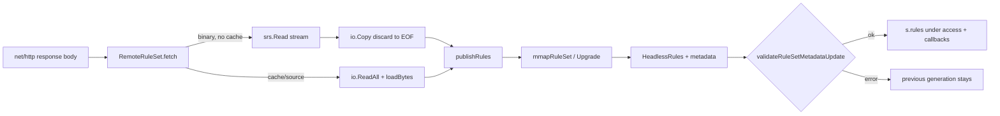

# Anywhere construction: cross-component debug audit

**Target:** `github.com/Piggy-Cat-bit-shadow/sing-box`, branch `testing`, worked directly on it.
**Debug start:** `93ca5351cb20ef659879273b2b4616c5a69a04a1`.
**Round-1 change under audit:** `d846fb6c8c9eef71f76242f4ba3e64f776c183c1` (streaming remote binary
rule-set load), plus the documentation commits `f38378dd417` and `93ca5351cb2`.
**Round-2 fixes:** `1f1775e37d257f6c66cb849478fa57b5c0592eae` (the defect),
`742da5e8df3f3429002e3924ebfcd6933777c47a` (the empty/garbage cases).
**Round-1 reports:** [`anywhere-deep-study.md`](anywhere-deep-study.md),
[`anywhere-audit-and-construction.md`](anywhere-audit-and-construction.md).

Environment: Windows 10 19044, Go 1.25.5 windows/amd64, CGO disabled; no bash, no Apple SDK/device.

---

## 1. What was actually changed in round 1 (verified from the tree, not the report)

| Change | Entry point | Owner | Buffer holder | Failure behaviour | Cleanup | Test |
|---|---|---|---|---|---|---|
| Parse `format: binary` remote rule-sets from `response.Body` when `cache_file` is absent | `RemoteRuleSet.fetch` → `loadBinaryStream` | `RemoteRuleSet` (same as before) | `srs.Read` decodes stream-to-matcher; no body slice | parse error → previous generation stays | `fetch`'s deferred `response.Body.Close` | `TestRemoteRuleSetStreamsBinaryWithoutCache` |
| Split `loadBytes` into decode + `publishRules` | `loadBytes` / `loadBinaryStream` → `publishRules` | `RemoteRuleSet` | published `[]adapter.HeadlessRule` under `access` | build/validate error → previous generation stays | old slice becomes garbage on next publish/`Cleanup`/`Close` | full `route/rule` suite |
| Cache branch unchanged | `fetch` else-branch | `fetch` | `content []byte` until `SaveRuleSet` | unchanged | unchanged | existing cache/update tests |

No new interface, goroutine, timer, lock, cache, callback or configuration field was added. The only
authority touched is the one that already owned rule-set generations (`RemoteRuleSet.rules`).

## 2. Coverage and boundaries

The change is confined to `route/rule`'s remote load path. It touches, but does not take over, these
existing authorities:

* `adapter.Scope`, `runtimecoord`, `power.Governor`, DNS generation, Router/Fake-IP, Sniff, TUN and the
  protocol pools are **not** involved: the change runs at a rule-set refresh, not on a flow, packet,
  network epoch or sleep event.
* The rule-set generation remains owned by `RemoteRuleSet.rules` and published only in `publishRules`.
* `CacheFile` remains the owner of the download bytes when it is configured; the streaming branch is
  not taken there.

## 3. Ownership matrix

| Resource | Acquire | Transfer | Release | Evidence |
|---|---|---|---|---|
| HTTP response body | `http.Client.Do` | `srs.Read` borrows it; then `io.Copy(io.Discard)` drains | `fetch`'s `defer response.Body.Close` | truncation/empty/garbage tests; `unexpected EOF` propagated |
| Parsed rule set | local `option.PlainRuleSetCompat` from `srs.Read` | `publishRules` builds `rules` and assigns `s.rules` under `access` | previous slice becomes garbage; `Cleanup`/`Close` clear it | tests + existing `rule_set_ref_cleanup_test.go` |
| Cache content | only when `cacheFile != nil` (`io.ReadAll`) | `CacheFile.SaveRuleSet` | unchanged | existing update/validation tests |
| HTTP connection | transport | idle pool | `CloseIdleConnections` after every non-initial refresh (pre-existing) | source read: `fetch` (`if !isStart { defer s.httpClient.CloseIdleConnections() }`) |
| Context | `s.ctx` / request context | read by HTTP body | `RemoteRuleSet.Close` cancels; updater `Close` | not changed by this round |
| Notifications | callbacks copied under lock | called after unlock | list owned by `RemoteRuleSet` | unchanged code path |

The key invariant introduced by the debug fix: **a generation is published only after the response
body has been read to EOF**. Before the fix, "rules parsed" was enough.

## 4. Issue list

### BUG-02-1 — a body truncated after the last rule was accepted

**Severity:** P2 (silent acceptance of a failed download; rare truncation window, but it changes
failure semantics and could hide a broken cache/CDN).

**Reproduction:** a remote `format: binary` rule-set with no `cache_file`; the server declares a
`Content-Length` larger than it sends and stops after the complete rules. `srs.Read` returns after the
declared rules, so the round-1 streaming path called `publishRules` and `fetch` returned **nil**. The
read-all path it replaced read to EOF, returned `unexpected EOF`, and left the previous generation
live.

**Root cause:** `srs.Read` stops at the end of the rule list; the zlib footer and the bytes after it are
not consumed. The streaming change treated "parsed" as "loaded", dropping the read-all path's
end-of-body check.

**Fix (`1f1775e37d2`):** `loadBinaryStream` drains the body with `io.Copy(io.Discard, body)` **before**
`publishRules`, and returns the drain error. The drain uses one small buffer, not a full-body slice.

**Proof (red → green → parity):**

| Step | Result |
|---|---|
| `TestRemoteRuleSetStreamDoesNotPublishATruncatedBody` with the drain removed (streaming, no EOF check) | **FAIL**: `An error is expected but got nil` |
| Same test on the pre-round-1 code (`git show d846fb6^:route/rule/rule_set_remote.go`) | **PASS**: `unexpected EOF`, old generation stays |
| Same test on the fixed tree | **PASS**: `unexpected EOF`; `10.1.2.3` still matches; `192.168.1.1` does not |
| `TestRemoteRuleSetStreamsBinaryWithoutCache` | **PASS**, 125,464 B observed (119,848 B on an earlier run) for the 4 MiB fixture (bound 2 MiB) |
| `TestRemoteRuleSetStreamRejectsUnparseableBodies` (empty + garbage) | **PASS**: error, nothing published |
| Full `route/rule` suite | **PASS**, 2.220 s |

**Why the fix cannot break the cache path:** the drain exists only in `loadBinaryStream`, which is
called only from the `cacheFile == nil && format == binary` branch. The cache/source branches still use
`io.ReadAll` + `loadBytes` exactly as before; `publishRules` is their shared sink.

### Checked and not a defect

| Attack / concern | Result | Evidence |
|---|---|---|
| Empty body | `srs.Read` fails at the magic; no publish | test `unparseable/empty` |
| Garbage body | `srs.Read` fails; no publish | test `unparseable/garbage` |
| Body truncated **inside** the rules | `srs.Read` fails (zlib/read error); no publish | truncation test exercises the inside case only if the payload is cut before the rules; the empty/garbage cases cover the same branch |
| Body truncated **after** the rules | **was a defect** | BUG-02-1 |
| Wrong format (`source` JSON served as binary) | `srs.Read` rejects; no publish | same magic check; format switch unchanged for the source path |
| Cache path | unchanged | existing `rule_set_update_validation_test.go`, `rule_set_semantics_test.go` |
| Error text change | now `unexpected EOF`, matching the read-all path | truncation test log |
| `publishRules` partial publication | builds into a local slice; assigns under one lock; callbacks after unlock | source read; existing tests |
| Callback ordering / duplicate callbacks | unchanged code, same list | source read |
| Context cancellation mid-body | body read fails; no publish (same as read-all) | reasoned from `http` body + `srs.Read`; no dedicated test (see §7) |
| Concurrent `fetch` calls | not reachable: `StartContext` fetches before the updater starts; `RuleSetUpdater.loopUpdate` calls `updateOnce` serially | source read |
| Connection reuse | **not claimed**: `fetch` closes idle connections after every non-initial refresh, so the drain is not a keep-alive optimisation; it is the EOF check | source read |
| Memory of the drain | `io.Copy` uses a fixed 32 KiB buffer; the body is not retained | allocation test |
| Rule-set generation visibility | published only after full body read (now); old slice released by GC | truncation test asserts old rules remain |
| `with_low_memory` | no buffer geometry code touched; package suite passes under the tag | §6 |

## 5. Adversarial test design notes

* The truncation test uses a **two-generation fixture**: generation 1 matches `10.0.0.0/8`, generation 2
  matches `192.168.0.0/16`. The second response declares 1024 bytes more than it sends. After the failed
  refresh, the test asserts both "old matches" and "new does not", so it cannot pass by publishing
  nothing at all.
* The red check was performed by **removing the drain from production code**, not by editing the test.
  The green check was performed after restoring the file, and the pre-round-1 code was run as a third
  data point to prove the test describes the old contract rather than the new implementation.
* The allocation test is a hard bound (`< tail/2`), not a benchmark report; it fails on any regression
  that buffers the download. It logs the observed figure for the record (125,464 B on the final tree, 119,848 B on an earlier run;
  the exact value varies by a few KiB with server-side buffering).
* No fault-injection hook was added to production code. The "short body" is produced by an honest
  `Content-Length` mismatch, which is what a broken CDN/proxy produces in the field.

## 6. Verification matrix

| Command | Result |
|---|---|
| `go test ./route/rule -count=1` | **PASS**, 2.220 s |
| `go test -tags with_low_memory ./route/rule -count=1` | **PASS**, 2.195 s |
| `go test ./route -count=1 -timeout 12m` | **PASS**, 421.389 s (includes the deliberate 6-minute kernel test) |
| `go test ./route -run TestRemoteRuleSetStream -v` | **PASS** (3 tests + 2 subcases) |
| `go vet ./route/rule` | clean |
| `gofmt -l route/rule` | clean |
| `go build ./route/...` (with and without `with_low_memory`) | clean |
| `go test -race ./route/rule` | **BLOCKED_BY_ENVIRONMENT** — CGO disabled, no mingw-w64 gcc |
| `scripts/ci/test-low-memory.sh` | **NOT_RUN** — no bash; the `with_low_memory` package test is the covered part |
| canonical Apple tag set | **BLOCKED_BY_ENVIRONMENT** on Windows: `tfogo_checklinkname0`/`badlinkname` fail the linker on `tfo-go`; not a defect of this change |
| iOS build / device `phys_footprint` | **NOT_RUN** — no Apple SDK/device |

## 7. Residual risks and unverified combinations

* **No `-race` run**: the changed code adds no shared state (parse and publish remain on the fetch
  goroutine; `access` is the existing lock), but this is reasoning, not a race-detector result.
* **Cancellation mid-body** is reasoned, not tested: a cancelled request fails the body read, and
  `srs.Read` returns that error before `publishRules`. A dedicated test would need a controllable
  blocking reader; the truncation test already proves the "read error → no publish" branch.
* **HTTP/2 and HTTP/3 transports** are not separately exercised; `response.Body` is the same
  `io.ReadCloser` contract. The drain reads to EOF, so an H2 stream is closed cleanly rather than reset.
* **Very large bodies**: the drain reads the remainder exactly as the old `io.ReadAll` did, but without
  retaining it; a server that streams an endless tail still blocks the refresh until the request context
  ends, same as before.
* **Cache-file profiles** keep the old peak; making them streaming would require a streaming
  `CacheFile.SaveRuleSet`, which is a contract change and was deliberately not done.

## 8. Architecture constraints kept

* No second rule-set generation owner: `s.rules` is still the only live-generation field, published
  under `access`.
* No second validation path: both loaders call `publishRules`.
* No new lifecycle: the fetch goroutine and the updater remain the owners; no timer, ticker or Scope
  entry was added.
* No new configuration; existing configs behave identically, including `cache_file`, `initial_path`,
  source format and the restore-from-cache path.
